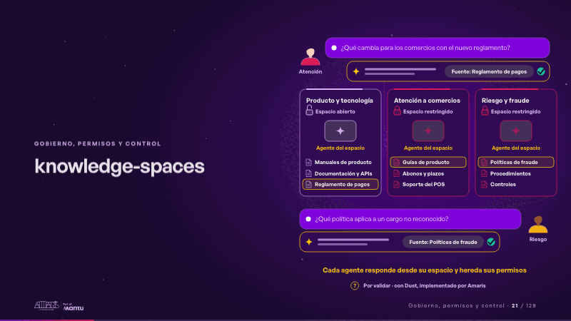
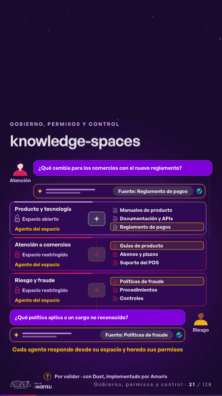

# knowledge-spaces · Gobierno, permisos y control

 

## Qué cuenta

Tres espacios del conocimiento de Pagalia, uno abierto y dos restringidos con candado, cada uno con su agente y sus fuentes; arriba pregunta atención, abajo pregunta riesgo.

## Cómo respira

Un bucle de 12 segundos: atención pregunta qué cambia con el nuevo reglamento; su espacio se abre para su equipo, su agente lee su espacio y el abierto, choca con el candado de riesgo y responde con la fuente. Luego riesgo pregunta: solo su espacio se abre, para su equipo, y su agente responde con la fuente.

## Cuándo usarla

Intención: **Gobierno, permisos y control** (governance, data). Verticales: cualquiera. Layout `left`. Origen: dcd · escena de catálogo (pagos). El snippet completo, listo para pegar en un storyboard: [`snippets/knowledge-spaces.json`](../../snippets/knowledge-spaces.json).

## Args

```json
{
 "layout": "left",
 "scene": "knowledge-spaces",
 "args": {
  "who": [
   "‹como: Atención›",
   "‹como: Riesgo›"
  ],
  "ask1": "‹como: ¿Qué cambia para los comercios con el nuevo reglamento?›",
  "src1": "‹como: Fuente: Reglamento de pagos›",
  "ask2": "‹como: ¿Qué política aplica a un cargo no reconocido?›",
  "src2": "‹como: Fuente: Políticas de fraude›",
  "spaces": [
   [
    "‹como: Producto y tecnología›",
    "‹como: Espacio abierto›",
    false,
    [
     "‹como: Manuales de producto›",
     "‹como: Documentación y APIs›",
     "‹como: Reglamento de pagos›"
    ]
   ],
   [
    "‹como: Atención a comercios›",
    "‹como: Espacio restringido›",
    true,
    [
     "‹como: Guías de producto›",
     "‹como: Abonos y plazos›",
     "‹como: Soporte del POS›"
    ]
   ],
   [
    "‹como: Riesgo y fraude›",
    "‹como: Espacio restringido›",
    true,
    [
     "‹como: Políticas de fraude›",
     "‹como: Procedimientos›",
     "‹como: Controles›"
    ]
   ]
  ],
  "agent": "‹como: Agente del espacio›",
  "deny": "‹como: Sin acceso›",
  "rule": "‹como: Cada agente responde desde su espacio y hereda sus permisos›",
  "foot": "‹como: Por validar · con Dust, implementado por Amaris›"
 }
}
```

## What it is

Governance, permissions and control scene, layout «left», for any decks. It lands at a glance, then breathes in a slow loop; its args (agent, ask1, ask2, deny, foot, rule, spaces, src1, src2, who) carry every visible word, so the same scene serves a new client once the texts are rewritten.

## Relacionadas · Related

- [chain-tap · Diseño técnico por capas](chain-tap.md)
- [discovery · Próximo paso: formas de empezar y discovery](discovery.md)
- [repeat-story · La brecha: su idea y lo que pasa cuando no se cumple](repeat-story.md)
- [hypotheses-live · Hipótesis por validar](hypotheses-live.md)
- [tickets-live · Cierre: su futuro, funcionando (el lema)](tickets-live.md)
- [hypotheses-quarter · Portada: su promesa](hypotheses-quarter.md)

Fuente · source: [`scenes/story/pagos_s04_06.py`](../../scenes/story/pagos_s04_06.py) · sha256 `6ae7f109a628`
