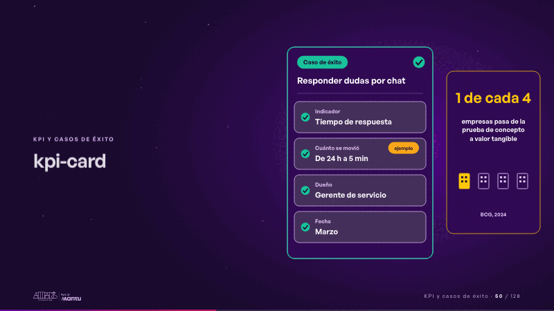
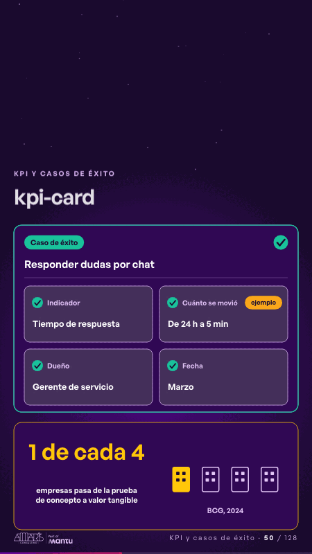

# kpi-card · KPI y casos de éxito

 

## Qué cuenta

La tarjeta «Caso de uso · Responder dudas por chat» con cuatro campos vacíos; a su lado, quieta en su marco, la cifra «1 de cada 4» con su fuente.

## Cómo respira

Los campos se llenan uno a uno: indicador, cuánto se movió (un ejemplo, rotulado así), dueño y fecha; con los cuatro, la tarjeta se vuelve verde y pasa a «Caso de éxito», y la empresa encendida de la cifra responde. La cifra no se mueve. Cuadro final: el caso de éxito completo y la cifra fija.

## Cuándo usarla

Intención: **KPI y casos de éxito** (kpi, proof). Verticales: formacion, cualquiera. Layout `left`. Origen: Clase VR (formación) · diapositiva «Un caso de éxito dice qué KPI movió y cuánto». El snippet completo, listo para pegar en un storyboard: [`snippets/kpi-card.json`](../../snippets/kpi-card.json).

## Args

```json
{
 "layout": "left",
 "scene": "kpi-card",
 "args": {
  "case_label": "‹como: Caso de uso›",
  "success": "‹como: Caso de éxito›",
  "case": "‹como: Responder dudas por chat›",
  "fields": [
   [
    "‹como: Indicador›",
    "‹como: Tiempo de respuesta›"
   ],
   [
    "‹como: Cuánto se movió›",
    "‹como: De 24 h a 5 min›"
   ],
   [
    "‹como: Dueño›",
    "‹como: Gerente de servicio›"
   ],
   [
    "‹como: Fecha›",
    "‹como: Marzo›"
   ]
  ],
  "example": "‹como: ejemplo›",
  "figure": "‹como: 1 de cada 4›",
  "label": "‹como: empresas pasa de la prueba de concepto a valor tangible›",
  "source": "‹como: BCG, 2024›"
 }
}
```

## What it is

KPIs and success cases scene, layout «left», for formacion, any decks. It lands at a glance, then breathes in a slow loop; its args (case, case_label, example, fields, figure, label, source, success) carry every visible word, so the same scene serves a new client once the texts are rewritten.

## Relacionadas · Related

- [evidence · La prueba y la evidencia](evidence.md)
- [criterion · El criterio: retorno o habilitador](criterion.md)
- [discovery · Próximo paso: formas de empezar y discovery](discovery.md)
- [outside-business · Desde afuera: lo que vimos en fuentes públicas](outside-business.md)
- [shared-asset · Lo que sus equipos comparten: el dato](shared-asset.md)
- [repeat-story · La brecha: su idea y lo que pasa cuando no se cumple](repeat-story.md)

Fuente · source: [`scenes/story/formacion_s10_12.py`](../../scenes/story/formacion_s10_12.py) · sha256 `e51f23629e2f`
