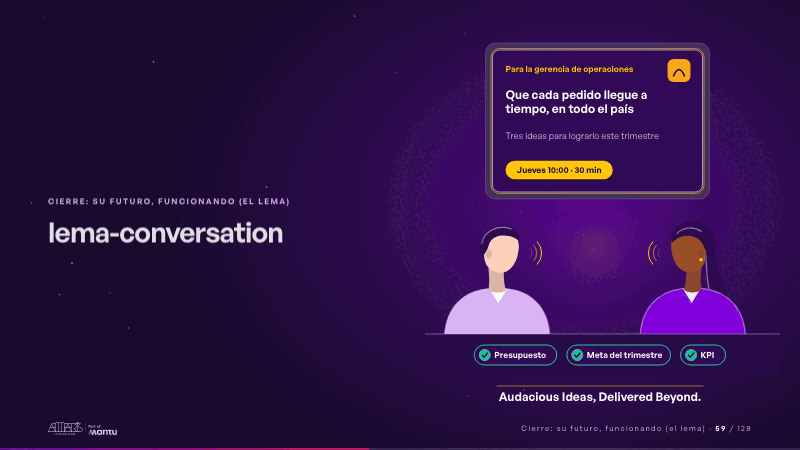
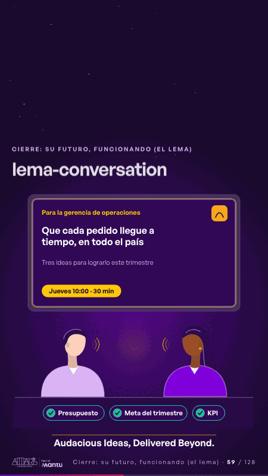

# lema-conversation · Cierre: su futuro, funcionando (el lema)

 

## Qué cuenta

La mesa del jueves de la diapositiva 1: detrás, en la pantalla, la portada hecha para ella; a un lado tú y al otro la gerente, sin rostro, frente a frente.

## Cómo respira

Conversan por turnos, las ondas van y vuelven; mientras hablan, sus tres preocupaciones de la diapositiva 4 reciben su visto sobre la mesa (presupuesto, meta del trimestre, KPI); al final hablan a la vez y aparece la firma «Audacious Ideas, Delivered Beyond.». Cuadro final: la conversación, los tres vistos y la firma.

## Cuándo usarla

Intención: **Cierre: su futuro, funcionando (el lema)** (vision). Verticales: formacion. Layout `left`. Origen: Clase VR (formación) · diapositiva «Planea la conversación. Las diapositivas vienen solas.». El snippet completo, listo para pegar en un storyboard: [`snippets/lema-conversation.json`](../../snippets/lema-conversation.json).

## Args

```json
{
 "layout": "left",
 "scene": "lema-conversation",
 "args": {
  "for_whom": "‹como: Para la gerencia de operaciones›",
  "promise": "‹como: Que cada pedido llegue a tiempo, en todo el país›",
  "cover_sub": "‹como: Tres ideas para lograrlo este trimestre›",
  "meeting": "‹como: Jueves 10:00 · 30 min›",
  "worries": [
   "‹como: Presupuesto›",
   "‹como: Meta del trimestre›",
   "‹como: KPI›"
  ],
  "sign": "‹como: Audacious Ideas, Delivered Beyond.›"
 }
}
```

## What it is

Closing: their future, working scene, layout «left», for formacion decks. It lands at a glance, then breathes in a slow loop; its args (cover_sub, for_whom, meeting, promise, sign, worries) carry every visible word, so the same scene serves a new client once the texts are rewritten.

## Relacionadas · Related

- [discovery · Próximo paso: formas de empezar y discovery](discovery.md)
- [prospect-cover · Portada: su promesa](prospect-cover.md)
- [week-calendar · La brecha: su idea y lo que pasa cuando no se cumple](week-calendar.md)
- [hypotheses-live · Hipótesis por validar](hypotheses-live.md)
- [criterion · El criterio: retorno o habilitador](criterion.md)
- [outside-business · Desde afuera: lo que vimos en fuentes públicas](outside-business.md)

Fuente · source: [`scenes/story/formacion_s19_20.py`](../../scenes/story/formacion_s19_20.py) · sha256 `239f62ef0885`
