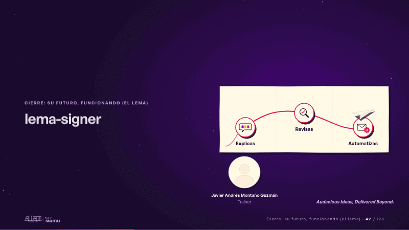
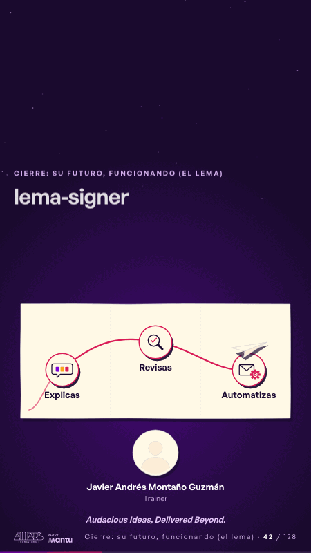

# lema-signer · Cierre: su futuro, funcionando (el lema)

 

## Qué cuenta

El logo del cliente arriba, grande y al centro; debajo, el mapa de la estrategia con sus tres paradas en la cinta magenta, y la foto del trainer.

## Cómo respira

El avión de papel de la portada vuelve, recorre la ruta del mapa encendiendo cada parada (explicas, revisas, automatizas) y se posa en la última; aparece «Audacious Ideas, Delivered Beyond.» en la esquina. Cuadro final: avión posado, logo del cliente, trainer con nombre y rol, y la firma.

## Cuándo usarla

Intención: **Cierre: su futuro, funcionando (el lema)** (vision). Verticales: cualquiera. Layout `left`; mundo papel. Origen: dcd · escena de catálogo (fidelización). El snippet completo, listo para pegar en un storyboard: [`snippets/lema-signer.json`](../../snippets/lema-signer.json).

## Args

```json
{
 "layout": "left",
 "scene": "lema-signer",
 "args": {
  "stops": [
   "‹como: Explicas›",
   "‹como: Revisas›",
   "‹como: Automatizas›"
  ],
  "name": "‹como: Javier Andrés Montaño Guzmán›",
  "role": "‹como: Trainer›",
  "sign": "‹como: Audacious Ideas, Delivered Beyond.›"
 }
}
```

## What it is

Closing: their future, working scene, layout «left», for any decks. It lands at a glance, then breathes in a slow loop; its args (name, role, sign, stops) carry every visible word, so the same scene serves a new client once the texts are rewritten.

## Relacionadas · Related

- [discovery · Próximo paso: formas de empezar y discovery](discovery.md)
- [mondays-sent · La prueba y la evidencia](mondays-sent.md)
- [paper-hero · Portada: su promesa](paper-hero.md)
- [pinned-request · La brecha: su idea y lo que pasa cuando no se cumple](pinned-request.md)
- [review-lens · Gobierno, permisos y control](review-lens.md)
- [strategy-map · El mecanismo: cómo cambiaría su operación](strategy-map.md)

Fuente · source: [`scenes/story/fidelizacion_s01_15.py`](../../scenes/story/fidelizacion_s01_15.py) · sha256 `c89653556c57`
