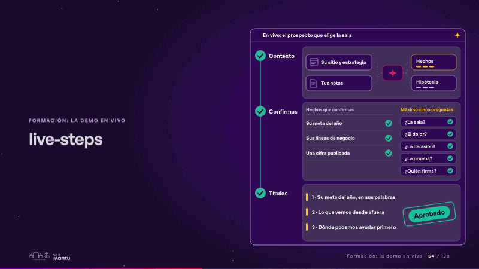
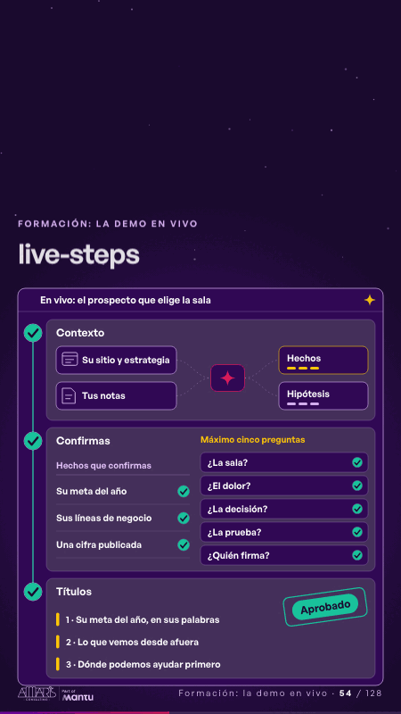

# live-steps · Formación: la demo en vivo

 

## Qué cuenta

Tu pantalla en vivo con tres etapas en columna: Contexto (su sitio y tus notas, el skill, hechos e hipótesis), Confirmas (la tabla de hechos y las cinco preguntas) y Títulos.

## Cómo respira

Se encienden en orden: su sitio y tus notas fluyen al skill y se separan en hechos e hipótesis; cada hecho recibe su visto y las cinco preguntas se responden una a una; los títulos se encienden y cae el sello «Aprobado». Cuadro final: las tres etapas con visto y «Aprobado».

## Cuándo usarla

Intención: **Formación: la demo en vivo** (demo, process). Verticales: formacion. Layout `left`. Origen: Clase VR (formación) · diapositiva «Le das contexto, confirmas hechos y apruebas títulos». El snippet completo, listo para pegar en un storyboard: [`snippets/live-steps.json`](../../snippets/live-steps.json).

## Args

```json
{
 "layout": "left",
 "scene": "live-steps",
 "args": {
  "screen": "‹como: En vivo: el prospecto que elige la sala›",
  "phases": [
   "‹como: Contexto›",
   "‹como: Confirmas›",
   "‹como: Títulos›"
  ],
  "sources": [
   "‹como: Su sitio y estrategia›",
   "‹como: Tus notas›"
  ],
  "sorted": [
   "‹como: Hechos›",
   "‹como: Hipótesis›"
  ],
  "known_head": "‹como: Hechos que confirmas›",
  "known": [
   "‹como: Su meta del año›",
   "‹como: Sus líneas de negocio›",
   "‹como: Una cifra publicada›"
  ],
  "ask_head": "‹como: Máximo cinco preguntas›",
  "questions": [
   "‹como: ¿La sala?›",
   "‹como: ¿El dolor?›",
   "‹como: ¿La decisión?›",
   "‹como: ¿La prueba?›",
   "‹como: ¿Quién firma?›"
  ],
  "titles": [
   "‹como: 1 · Su meta del año, en sus palabras›",
   "‹como: 2 · Lo que vemos desde afuera›",
   "‹como: 3 · Dónde podemos ayudar primero›"
  ],
  "approved": "‹como: Aprobado›"
 }
}
```

## What it is

Training: live demo scene, layout «left», for formacion decks. It lands at a glance, then breathes in a slow loop; its args (approved, ask_head, known, known_head, phases, questions, screen, sorted, sources, titles) carry every visible word, so the same scene serves a new client once the texts are…

## Relacionadas · Related

- [build-deliver · Formación: la demo en vivo](build-deliver.md)
- [mirroring · El mecanismo: cómo cambiaría su operación](mirroring.md)
- [skill-handoff · Formación: la demo en vivo](skill-handoff.md)
- [titles-thread · El mecanismo: cómo cambiaría su operación](titles-thread.md)
- [two-seconds · El mecanismo: cómo cambiaría su operación](two-seconds.md)
- [automation-stairs · El mecanismo: cómo cambiaría su operación](automation-stairs.md)

Fuente · source: [`scenes/story/formacion_s13_15.py`](../../scenes/story/formacion_s13_15.py) · sha256 `b70c079dfe51`
