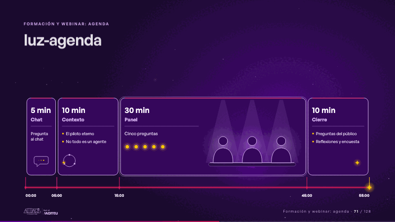
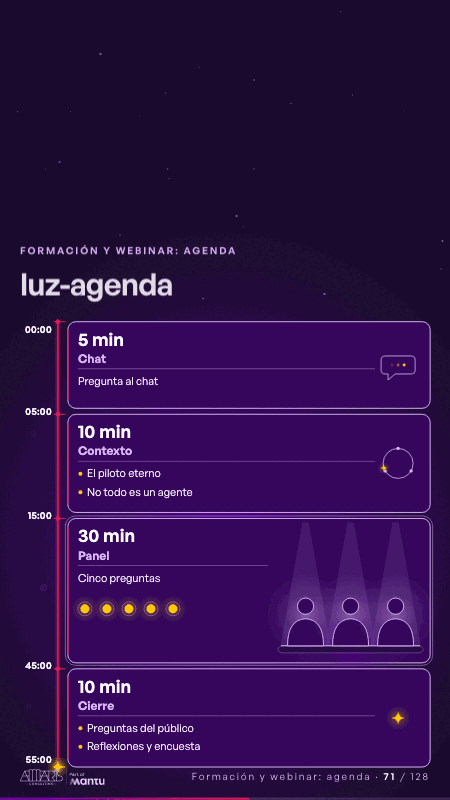

# luz-agenda · Formación y webinar: agenda

 

## Qué cuenta

Cuatro tarjetas de vidrio a lo ancho, cada una del tamaño de su parte de los 55 minutos, con su duración grande y su nombre: «5 min» Chat, «10 min» Contexto, «30 min» Panel y «10 min» Cierre, cada una con sus contenidos; debajo, una línea de tiempo de luz con sus marcas 00:00 · 05:00 · 15:00 · 45:00 · 55:00.

## Cómo respira

Una chispa recorre la línea de tiempo, que se carga a su paso, y enciende cada tarjeta al llegar a su marca: el chat, que empieza a escribir; el contexto («El piloto eterno» y «No todo es un agente»), con su ciclo en miniatura; el panel, el más ancho, con sus tres asientos bajo los focos, donde se encienden una a una sus cinco preguntas y los focos quedan latiendo; y el cierre, con las preguntas del público, las reflexiones y la encuesta; al final se detiene en 55:00, que se enciende. Cuadro final: las cuatro tarjetas encendidas con su duración, el panel latiendo y la chispa en 55:00.

## Cuándo usarla

Intención: **Formación y webinar: agenda** (agenda). Verticales: cualquiera. Layout `top`; mundo luz. Origen: webinar «IA: ¿el fin del piloto eterno?» · diapositiva «55 minutos». El snippet completo, listo para pegar en un storyboard: [`snippets/luz-agenda.json`](../../snippets/luz-agenda.json).

## Args

```json
{
 "layout": "top",
 "scene": "luz-agenda",
 "args": {
  "steps": [
   "‹como: Pregunta al chat›",
   "‹como: El piloto eterno›",
   "‹como: No todo es un agente›",
   "‹como: Cinco preguntas›",
   "‹como: Preguntas del público›",
   "‹como: Reflexiones y encuesta›"
  ],
  "blocks": [
   [
    "‹como: Chat · 5 min›",
    "‹como: 00:00›"
   ],
   [
    "‹como: Contexto · 10 min›",
    "‹como: 05:00›"
   ],
   [
    "‹como: Panel · 30 min›",
    "‹como: 15:00›"
   ],
   [
    "‹como: Cierre · 10 min›",
    "‹como: 45:00›"
   ]
  ],
  "end": "‹como: 55:00›"
 }
}
```

## What it is

Training and webinar: agenda scene, layout «top», for any decks. It lands at a glance, then breathes in a slow loop; its args (blocks, end, steps) carry every visible word, so the same scene serves a new client once the texts are rewritten.

## Relacionadas · Related

—

Fuente · source: [`scenes/story/webinar_s01_15.py`](../../scenes/story/webinar_s01_15.py) · sha256 `32ce7205f2f7`
