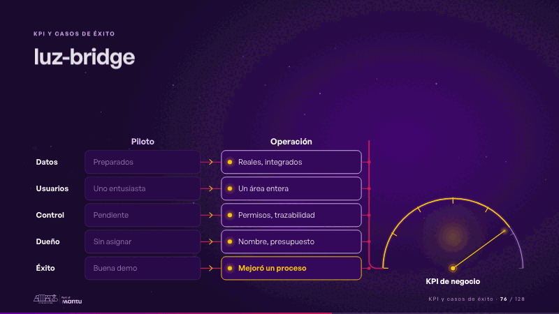
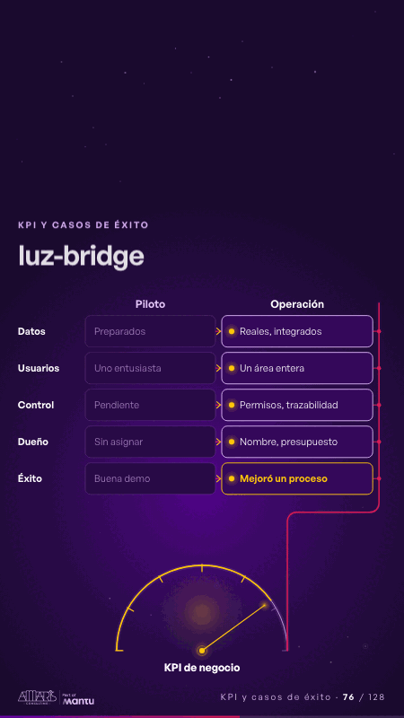

# luz-bridge · KPI y casos de éxito

 

## Qué cuenta

La tabla Piloto | Operación con sus cinco filas (datos, usuarios, control, dueño, éxito): el piloto encendido, la operación apagada; por su borde derecho baja la estela magenta hasta un medidor «KPI de negocio» con la aguja abajo.

## Cómo respira

La chispa baja por la estela fila a fila (datos, usuarios, control, dueño, éxito): en cada una la celda del piloto se apaga y la de la operación se ilumina; con «Mejoró un proceso», en dorado, la chispa llega al medidor y la aguja sube, sin número. Cuadro final: las cinco filas con la operación encendida y la aguja arriba.

## Cuándo usarla

Intención: **KPI y casos de éxito** (kpi, process). Verticales: cualquiera. Layout `top`; mundo luz. Origen: webinar «IA: ¿el fin del piloto eterno?» · diapositiva «Piloto y operación no se parecen». El snippet completo, listo para pegar en un storyboard: [`snippets/luz-bridge.json`](../../snippets/luz-bridge.json).

## Args

```json
{
 "layout": "top",
 "scene": "luz-bridge",
 "args": {
  "head": [
   "",
   "‹como: Piloto›",
   "‹como: Operación›"
  ],
  "rows": [
   [
    "‹como: Datos›",
    "‹como: Preparados›",
    "‹como: Reales, integrados›"
   ],
   [
    "‹como: Usuarios›",
    "‹como: Uno entusiasta›",
    "‹como: Un área entera›"
   ],
   [
    "‹como: Control›",
    "‹como: Pendiente›",
    "‹como: Permisos, trazabilidad›"
   ],
   [
    "‹como: Dueño›",
    "‹como: Sin asignar›",
    "‹como: Nombre, presupuesto›"
   ],
   [
    "‹como: Éxito›",
    "‹como: Buena demo›",
    "‹como: Mejoró un proceso›"
   ]
  ],
  "gauge": "‹como: KPI de negocio›"
 }
}
```

## What it is

KPIs and success cases scene, layout «top», for any decks. It lands at a glance, then breathes in a slow loop; its args (gauge, head, rows) carry every visible word, so the same scene serves a new client once the texts are rewritten.

## Relacionadas · Related

- [panel-questions · En vivo: panel](panel-questions.md)
- [reflections-live · En vivo: reflexiones y preguntas](reflections-live.md)
- [discovery · Próximo paso: formas de empezar y discovery](discovery.md)
- [luz-divider · La brecha: su idea y lo que pasa cuando no se cumple](luz-divider.md)
- [luz-end · Cierre: su futuro, funcionando (el lema)](luz-end.md)
- [luz-figures · Una cifra pública (estática, con fuente)](luz-figures.md)

Fuente · source: [`scenes/story/webinar_s01_15.py`](../../scenes/story/webinar_s01_15.py) · sha256 `32ce7205f2f7`
