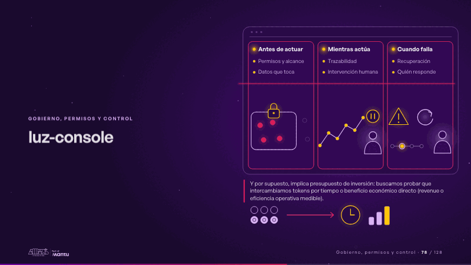
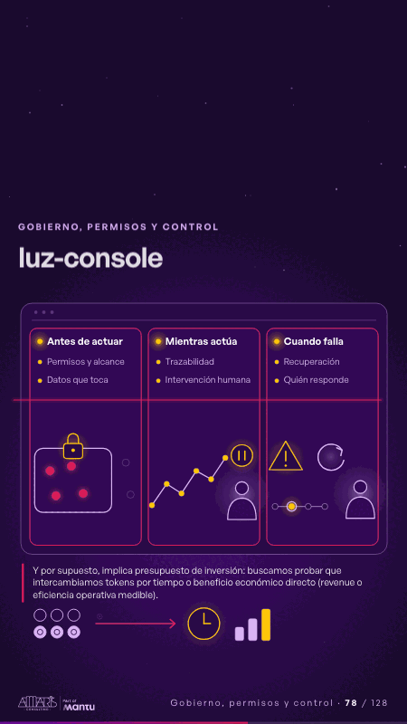

# luz-console · Gobierno, permisos y control

 

## Qué cuenta

Una consola de tres paneles (antes de actuar, mientras actúa, cuando falla) con sus controles apagados; la estela del trabajo delegado entra por la izquierda y la cruza; debajo, la línea del presupuesto y su intercambio: fichas, una flecha, un reloj y tres barras.

## Cómo respira

La chispa cruza la consola: antes de actuar, el alcance se cierra con su candado y se encienden solo los datos que toca; mientras actúa, el rastro se dibuja nodo a nodo y una persona toma el control de pausa; cuando falla, una alerta serena, la recuperación rebobina y se ilumina quién responde; al final las fichas viajan y se encienden el tiempo y el beneficio. Cuadro final: los tres paneles encendidos y el intercambio del presupuesto resuelto.

## Cuándo usarla

Intención: **Gobierno, permisos y control** (governance). Verticales: cualquiera. Layout `left`; mundo luz. Origen: webinar «IA: ¿el fin del piloto eterno?» · diapositiva «La autonomía cuesta». El snippet completo, listo para pegar en un storyboard: [`snippets/luz-console.json`](../../snippets/luz-console.json).

## Args

```json
{
 "layout": "left",
 "scene": "luz-console",
 "args": {
  "panels": [
   [
    "‹como: Antes de actuar›",
    [
     "‹como: Permisos y alcance›",
     "‹como: Datos que toca›"
    ]
   ],
   [
    "‹como: Mientras actúa›",
    [
     "‹como: Trazabilidad›",
     "‹como: Intervención humana›"
    ]
   ],
   [
    "‹como: Cuando falla›",
    [
     "‹como: Recuperación›",
     "‹como: Quién responde›"
    ]
   ]
  ],
  "budget": "‹como: Y por supuesto, implica presupuesto de inversión: buscamos probar que intercambiamos tokens por tiempo o beneficio económico directo (revenue o eficiencia operativa medible).›"
 }
}
```

## What it is

Governance, permissions and control scene, layout «left», for any decks. It lands at a glance, then breathes in a slow loop; its args (budget, panels) carry every visible word, so the same scene serves a new client once the texts are rewritten.

## Relacionadas · Related

- [data-architecture · Diseño técnico por capas](data-architecture.md)
- [data-lifecycle · Lo que sus equipos comparten: el dato](data-lifecycle.md)
- [facts-columns · Lo que sus equipos comparten: el dato](facts-columns.md)
- [federated-live · Gobierno, permisos y control](federated-live.md)
- [infra-topology · Diseño técnico por capas](infra-topology.md)
- [knowledge-spaces · Gobierno, permisos y control](knowledge-spaces.md)

Fuente · source: [`scenes/story/webinar_s01_15.py`](../../scenes/story/webinar_s01_15.py) · sha256 `32ce7205f2f7`
