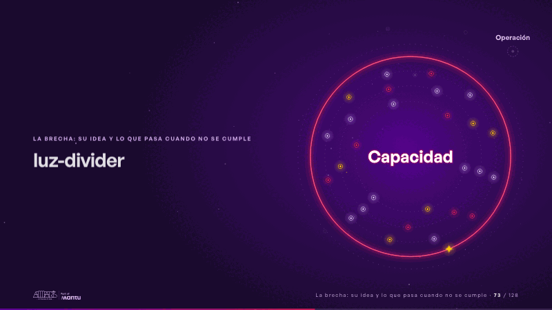
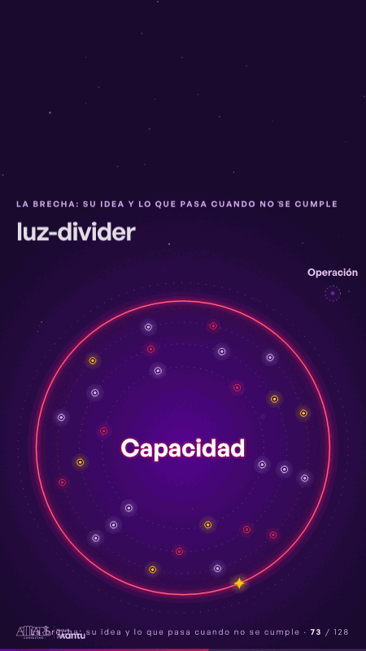

# luz-divider · La brecha: su idea y lo que pasa cuando no se cumple

 

## Qué cuenta

Una órbita grande de luz magenta se traza sola; dentro, «Capacidad» en grande y tres órbitas interiores con muchos satélites pequeños, apagados, que giran cada uno a su ritmo; afuera, tenue y hueco, un punto que dice «Operación».

## Cómo respira

La chispa recorre la órbita y, justo después de la cima, sale hacia «Operación»: se frena cerca de él, que responde con un anillo tenue, y el trazo se curva de vuelta a la órbita, que se cierra sobre sí misma con un destello. De cada cierre corre una onda hacia adentro que enciende la mitad de los satélites: capacidad por todas partes. La primera vuelta enciende «Capacidad»; la segunda la hace brillar más y enciende el resto. «Operación» sigue esperando, sin encenderse. Cuadro final: órbita cerrada y brillante, todos los satélites encendidos, «Capacidad» encendida, la chispa en su trazo y «Operación» tenue afuera.

## Cuándo usarla

Intención: **La brecha: su idea y lo que pasa cuando no se cumple** (gap). Verticales: cualquiera. Layout `left`; mundo luz. Origen: webinar «IA: ¿el fin del piloto eterno?» · diapositiva «El piloto eterno». El snippet completo, listo para pegar en un storyboard: [`snippets/luz-divider.json`](../../snippets/luz-divider.json).

## Args

```json
{
 "layout": "left",
 "scene": "luz-divider",
 "args": {
  "inside": "‹como: Capacidad›",
  "outside": "‹como: Operación›"
 }
}
```

## What it is

The gap scene, layout «left», for any decks. It lands at a glance, then breathes in a slow loop; its args (inside, outside) carry every visible word, so the same scene serves a new client once the texts are rewritten.

## Relacionadas · Related

- [luz-figures · Una cifra pública (estática, con fuente)](luz-figures.md)
- [luz-hero · Portada: su promesa](luz-hero.md)
- [discovery · Próximo paso: formas de empezar y discovery](discovery.md)
- [luz-bridge · KPI y casos de éxito](luz-bridge.md)
- [luz-end · Cierre: su futuro, funcionando (el lema)](luz-end.md)
- [panel-questions · En vivo: panel](panel-questions.md)

Fuente · source: [`scenes/story/webinar_s01_15.py`](../../scenes/story/webinar_s01_15.py) · sha256 `32ce7205f2f7`
