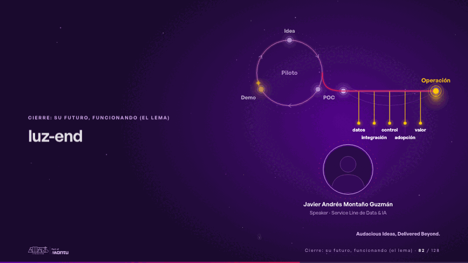
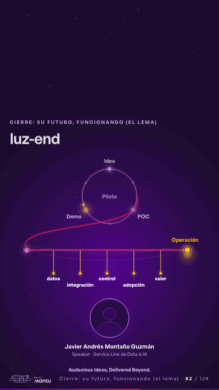

# luz-end · Cierre: su futuro, funcionando (el lema)

 

## Qué cuenta

El anillo del piloto, más grande, con «Piloto» en su centro; a la derecha, el puente de cinco pilares hacia la operación; abajo, el retrato de Javier en un anillo de luz, con su nombre y su rol; al fondo, estrellas y una cámara que respira.

## Cómo respira

La chispa del anillo pinta una última vuelta magenta; donde el piloto no tenía salida, estalla un destello y la estela sale por fin, baja con su cola de cometa al puente y lo cruza encendiendo sus cinco pilares (datos, integración, control, adopción, valor), mientras el anillo queda en calma detrás; aterriza en la operación, que estalla en dorado y late, y aparece «Audacious Ideas, Delivered Beyond.». Cuadro final: la estela aterrizada en la operación, el anillo quieto, el retrato del speaker y la firma.

## Cuándo usarla

Intención: **Cierre: su futuro, funcionando (el lema)** (vision). Verticales: cualquiera. Layout `left`; mundo luz. Origen: webinar «IA: ¿el fin del piloto eterno?» · diapositiva «Make it happen, together.». El snippet completo, listo para pegar en un storyboard: [`snippets/luz-end.json`](../../snippets/luz-end.json).

## Args

```json
{
 "layout": "left",
 "scene": "luz-end",
 "args": {
  "stops": [
   "‹como: Idea›",
   "‹como: POC›",
   "‹como: Demo›"
  ],
  "bridge": [
   "‹como: datos›",
   "‹como: integración›",
   "‹como: control›",
   "‹como: adopción›",
   "‹como: valor›"
  ],
  "from": "‹como: Piloto›",
  "to": "‹como: Operación›",
  "name": "‹como: Javier Andrés Montaño Guzmán›",
  "role": "‹como: Speaker · Service Line de Data & IA›",
  "sign": "‹como: Audacious Ideas, Delivered Beyond.›"
 }
}
```

## What it is

Closing: their future, working scene, layout «left», for any decks. It lands at a glance, then breathes in a slow loop; its args (bridge, from, name, role, sign, stops, to) carry every visible word, so the same scene serves a new client once the texts are rewritten.

## Relacionadas · Related

- [discovery · Próximo paso: formas de empezar y discovery](discovery.md)
- [luz-bridge · KPI y casos de éxito](luz-bridge.md)
- [luz-divider · La brecha: su idea y lo que pasa cuando no se cumple](luz-divider.md)
- [luz-figures · Una cifra pública (estática, con fuente)](luz-figures.md)
- [luz-hero · Portada: su promesa](luz-hero.md)
- [panel-questions · En vivo: panel](panel-questions.md)

Fuente · source: [`scenes/story/webinar_s01_15.py`](../../scenes/story/webinar_s01_15.py) · sha256 `32ce7205f2f7`
