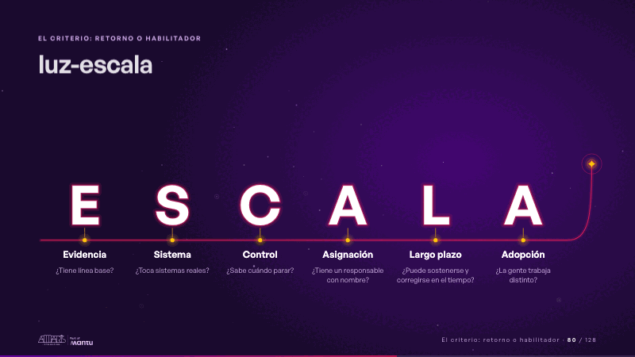
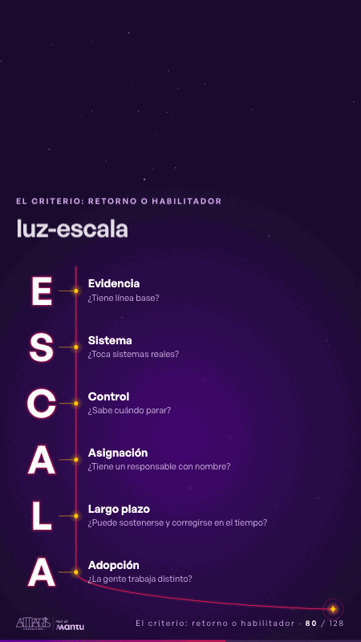

# luz-escala · El criterio: retorno o habilitador

 

## Qué cuenta

Seis letras grandes de luz en fila, E-S-C-A-L-A, apagadas (solo su contorno) sobre una línea magenta tenue, cada una con su palabra debajo.

## Cómo respira

Una chispa recorre la línea y el trazo brillante crece detrás de ella; se detiene bajo cada letra cada 1,6 s: se abre un anillo de luz en su punto, un destello toca la letra y se encienden la letra, su palabra y su pregunta, que quedan encendidas; tras la última A, el trazo sube a la derecha, hacia el panel, y su punto se enciende. Cuadro final: ESCALA encendida con sus seis palabras y preguntas, el trazo arriba y la chispa en su punta.

## Cuándo usarla

Intención: **El criterio: retorno o habilitador** (criterion). Verticales: cualquiera. Layout `top`; mundo luz. Origen: webinar «IA: ¿el fin del piloto eterno?» · diapositiva «¿Qué hace que una iniciativa esté lista para escalar?». El snippet completo, listo para pegar en un storyboard: [`snippets/luz-escala.json`](../../snippets/luz-escala.json).

## Args

```json
{
 "layout": "top",
 "scene": "luz-escala",
 "args": {
  "letters": [
   [
    "‹como: E›",
    "‹como: Evidencia›",
    "‹como: ¿Tiene línea base?›"
   ],
   [
    "‹como: S›",
    "‹como: Sistema›",
    "‹como: ¿Toca sistemas reales?›"
   ],
   [
    "‹como: C›",
    "‹como: Control›",
    "‹como: ¿Sabe cuándo parar?›"
   ],
   [
    "‹como: A›",
    "‹como: Asignación›",
    "‹como: ¿Tiene un responsable con nombre?›"
   ],
   [
    "‹como: L›",
    "‹como: Largo plazo›",
    "‹como: ¿Puede sostenerse y corregirse en el tiempo?›"
   ],
   [
    "‹como: A›",
    "‹como: Adopción›",
    "‹como: ¿La gente trabaja distinto?›"
   ]
  ]
 }
}
```

## What it is

The criterion: return or enabler scene, layout «top», for any decks. It lands at a glance, then breathes in a slow loop; its args (letters) carry every visible word, so the same scene serves a new client once the texts are rewritten.

## Relacionadas · Related

- [adr-decisions · Diseño técnico por capas](adr-decisions.md)
- [criterion · El criterio: retorno o habilitador](criterion.md)
- [criterion-b · El criterio: retorno o habilitador](criterion-b.md)
- [funnel-gates · Embudo](funnel-gates.md)
- [matrix-quadrants · Matriz](matrix-quadrants.md)
- [matrix-table · Matriz](matrix-table.md)

Fuente · source: [`scenes/story/webinar_s01_15.py`](../../scenes/story/webinar_s01_15.py) · sha256 `32ce7205f2f7`
