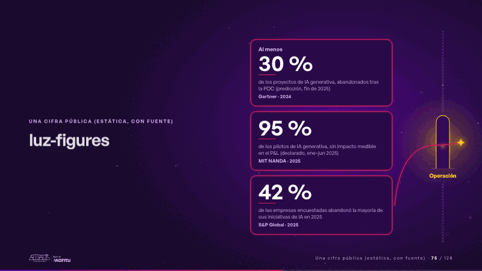
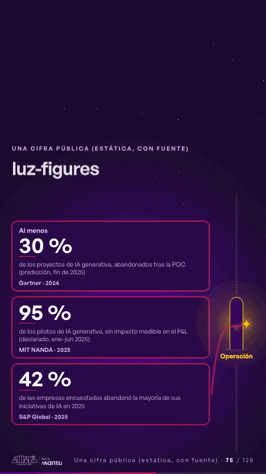

# luz-figures · Una cifra pública (estática, con fuente)

 

## Qué cuenta

Tres cifras grandes y quietas en tarjetas de vidrio oscuro, cada una con su alcance y su fuente; a la derecha, un muro de luz punteado con una sola puerta alta y estrecha: «Operación».

## Cómo respira

El borde de cada tarjeta se ilumina por turnos y de ella salen siete chispas hacia el muro: lo tocan, se deslizan buscando la puerta y se apagan. La última de la tercera tarjeta la cruza con su trazo magenta: la puerta se enciende, los tres bordes brillan juntos y la chispa queda encendida del otro lado. Las cifras no se mueven. Cuadro final: tres cifras quietas con sus bordes encendidos, la puerta encendida, el trazo magenta y una chispa del otro lado.

## Cuándo usarla

Intención: **Una cifra pública (estática, con fuente)** (figure). Verticales: cualquiera. Layout `left`; mundo luz. Origen: webinar «IA: ¿el fin del piloto eterno?» · diapositiva «¿Por qué escalar sigue siendo la excepción?». El snippet completo, listo para pegar en un storyboard: [`snippets/luz-figures.json`](../../snippets/luz-figures.json).

## Args

```json
{
 "layout": "left",
 "scene": "luz-figures",
 "args": {
  "figure": [
   {
    "pre": "‹como: Al menos›",
    "v": "‹como: 30 %›",
    "label": "‹como: de los proyectos de IA generativa, abandonados tras la POC (predicción, fin de 2025)›",
    "src": "‹como: Gartner · 2024›"
   },
   {
    "v": "‹como: 95 %›",
    "label": "‹como: de los pilotos de IA generativa, sin impacto medible en el P&L (declarado, ene–jun 2025)›",
    "src": "‹como: MIT NANDA · 2025›"
   },
   {
    "v": "‹como: 42 %›",
    "label": "‹como: de las empresas encuestadas abandonó la mayoría de sus iniciativas de IA en 2025›",
    "src": "‹como: S&P Global · 2025›"
   }
  ],
  "door": "‹como: Operación›"
 }
}
```

## What it is

A public figure, static and sourced scene, layout «left», for any decks. It lands at a glance, then breathes in a slow loop; its args (door, figure) carry every visible word, so the same scene serves a new client once the texts are rewritten.

## Relacionadas · Related

- [luz-divider · La brecha: su idea y lo que pasa cuando no se cumple](luz-divider.md)
- [discovery · Próximo paso: formas de empezar y discovery](discovery.md)
- [hypotheses-live · Hipótesis por validar](hypotheses-live.md)
- [luz-bridge · KPI y casos de éxito](luz-bridge.md)
- [luz-end · Cierre: su futuro, funcionando (el lema)](luz-end.md)
- [luz-hero · Portada: su promesa](luz-hero.md)

Fuente · source: [`scenes/story/webinar_s01_15.py`](../../scenes/story/webinar_s01_15.py) · sha256 `32ce7205f2f7`
