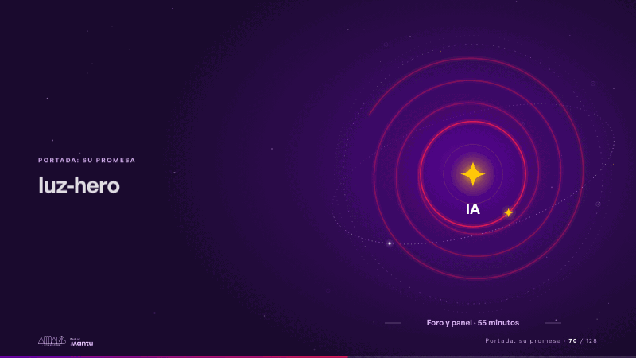
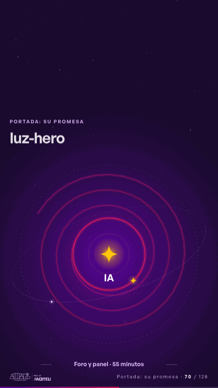

# luz-hero · Portada: su promesa

 

## Qué cuenta

La chispa «IA» encendida a la derecha del escenario, sobre un cielo de estrellas lejanas; dos órbitas punteadas, un plano orbital inclinado que pasa por detrás y por delante, y una estela magenta que la rodea en tres vueltas, cada una más ceñida; abajo, «Foro y panel · 55 minutos».

## Cómo respira

Una chispa recorre la estela vuelta tras vuelta hacia adentro y la estela se carga a su paso; al llegar al centro el anillo interior se cierra y se enciende, sale una onda, la chispa «IA» destella y las vueltas de afuera se atenúan; la chispa sigue girando en el anillo y la «IA» late cada tres segundos. Cuadro final (10,8 s): el anillo cerrado y encendido alrededor de la chispa, sin salida.

## Cuándo usarla

Intención: **Portada: su promesa** (hero). Verticales: cualquiera. Layout `left`; mundo luz. Origen: webinar «IA: ¿el fin del piloto eterno?» · diapositiva «IA: ¿el fin del piloto eterno?». El snippet completo, listo para pegar en un storyboard: [`snippets/luz-hero.json`](../../snippets/luz-hero.json).

## Args

```json
{
 "layout": "left",
 "scene": "luz-hero",
 "args": {
  "spark": "‹como: IA›",
  "format": "‹como: Foro y panel · 55 minutos›"
 }
}
```

## What it is

Cover: their promise scene, layout «left», for any decks. It lands at a glance, then breathes in a slow loop; its args (format, spark) carry every visible word, so the same scene serves a new client once the texts are rewritten.

## Relacionadas · Related

- [luz-divider · La brecha: su idea y lo que pasa cuando no se cumple](luz-divider.md)
- [discovery · Próximo paso: formas de empezar y discovery](discovery.md)
- [luz-bridge · KPI y casos de éxito](luz-bridge.md)
- [luz-end · Cierre: su futuro, funcionando (el lema)](luz-end.md)
- [luz-figures · Una cifra pública (estática, con fuente)](luz-figures.md)
- [panel-questions · En vivo: panel](panel-questions.md)

Fuente · source: [`scenes/story/webinar_s01_15.py`](../../scenes/story/webinar_s01_15.py) · sha256 `32ce7205f2f7`
