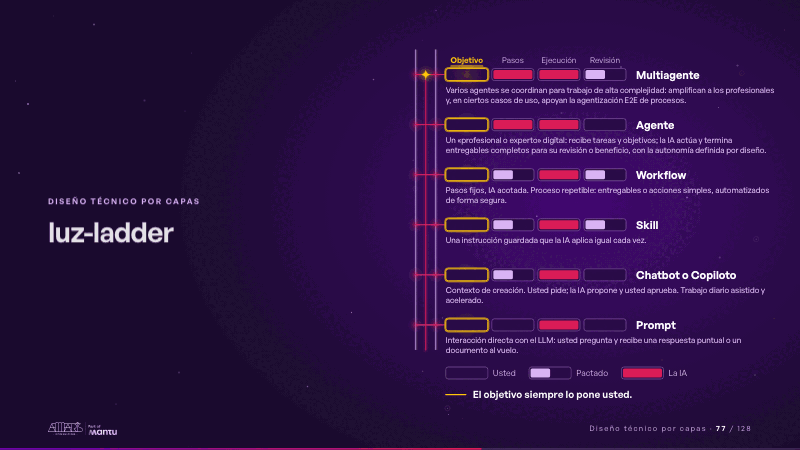
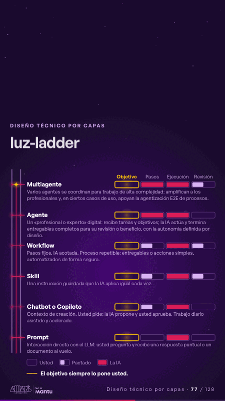

# luz-ladder · Diseño técnico por capas

 

## Qué cuenta

Una escalera de luz de seis peldaños, Prompt abajo y Multiagente arriba; cada peldaño con su riel de cuatro celdas (objetivo, pasos, ejecución, revisión) todavía vacío, su nombre y su frase; debajo, la leyenda (usted, pactado, la IA) y «El objetivo siempre lo pone usted.».

## Cómo respira

Una chispa sube por la escalera, un peldaño cada 1,56 s: el peldaño se enciende en magenta y su riel se llena según quién hace el trabajo (vacío, usted; a medias, pactado; lleno, la IA), mientras la celda del objetivo queda vacía con un brillo dorado propio. Cuadro final: los seis rieles llenos y la columna del objetivo vacía de abajo arriba.

## Cuándo usarla

Intención: **Diseño técnico por capas** (architecture, process). Verticales: cualquiera. Layout `left`; mundo luz. Origen: webinar «IA: ¿el fin del piloto eterno?» · diapositiva «No todo problema necesita un agente». El snippet completo, listo para pegar en un storyboard: [`snippets/luz-ladder.json`](../../snippets/luz-ladder.json).

## Args

```json
{
 "layout": "left",
 "scene": "luz-ladder",
 "args": {
  "cells": [
   "‹como: Objetivo›",
   "‹como: Pasos›",
   "‹como: Ejecución›",
   "‹como: Revisión›"
  ],
  "legend": [
   "‹como: Usted›",
   "‹como: Pactado›",
   "‹como: La IA›"
  ],
  "rungs": [
   [
    "‹como: Prompt›",
    "‹como: Interacción directa con el LLM: usted pregunta y recibe una respuesta puntual o un documento al vuelo.›",
    [
     0,
     0,
     2,
     0
    ]
   ],
   [
    "‹como: Chatbot o Copiloto›",
    "‹como: Contexto de creación. Usted pide; la IA propone y usted aprueba. Trabajo diario asistido y acelerado.›",
    [
     0,
     1,
     2,
     0
    ]
   ],
   [
    "‹como: Skill›",
    "‹como: Una instrucción guardada que la IA aplica igual cada vez.›",
    [
     0,
     1,
     2,
     1
    ]
   ],
   [
    "‹como: Workflow›",
    "‹como: Pasos fijos, IA acotada. Proceso repetible: entregables o acciones simples, automatizados de forma segura.›",
    [
     0,
     1,
     2,
     1
    ]
   ],
   [
    "‹como: Agente›",
    "‹como: Un «profesional o experto» digital: recibe tareas y objetivos; la IA actúa y termina entregables completos para su revisión o beneficio, con la autonomía definida por diseño.›",
    [
     0,
     2,
     2,
     0
    ]
   ],
   [
    "‹como: Multiagente›",
    "‹como: Varios agentes se coordinan para trabajo de alta complejidad: amplifican a los profesionales y, en ciertos casos de uso, apoyan la agentización E2E de procesos.›",
    [
     0,
     2,
     2,
     1
    ]
   ]
  ],
  "rule": "‹como: El objetivo siempre lo pone usted.›"
 }
}
```

## What it is

Layered technical design scene, layout «left», for any decks. It lands at a glance, then breathes in a slow loop; its args (cells, legend, rule, rungs) carry every visible word, so the same scene serves a new client once the texts are rewritten.

## Relacionadas · Related

- [automation-stairs · El mecanismo: cómo cambiaría su operación](automation-stairs.md)
- [solution-layers · Diseño técnico por capas](solution-layers.md)
- [adr-decisions · Diseño técnico por capas](adr-decisions.md)
- [arq-hero · Portada: su promesa](arq-hero.md)
- [before-after-lanes · Antes y después](before-after-lanes.md)
- [before-after-split · Antes y después](before-after-split.md)

Fuente · source: [`scenes/story/webinar_s01_15.py`](../../scenes/story/webinar_s01_15.py) · sha256 `32ce7205f2f7`
