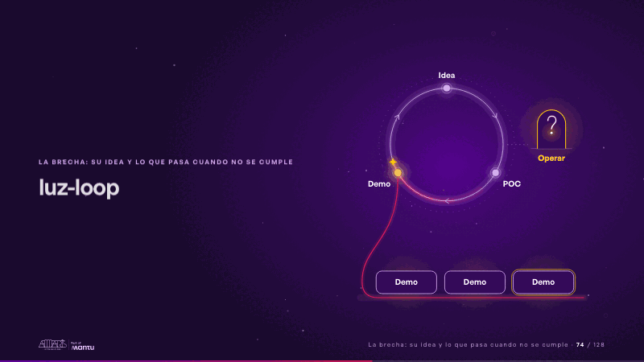
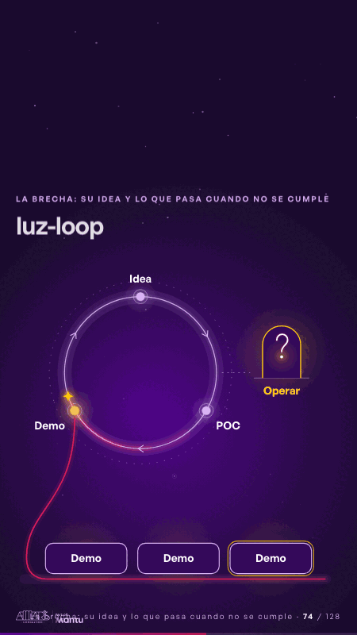

# luz-loop · La brecha: su idea y lo que pasa cuando no se cumple

 

## Qué cuenta

El anillo Idea → POC → Demo con sus tres nodos y la chispa girando con su estela magenta; fuera del anillo, la puerta «Operar» apagada y un trazo punteado que no llega; debajo, el hilo magenta baja de «Demo» a un estante con tres lugares vacíos.

## Cómo respira

La chispa gira cada 4 segundos: Idea, POC, Demo y vuelta a empezar; cada paso por «Demo» deja caer una demo más en el estante, y se van acumulando. A los 5 segundos una chispa se separa hacia «Operar»: la puerta se enciende y dentro se dibuja un signo de pregunta; la chispa se queda cerca, duda, y vuelve al anillo justo cuando pasa la otra. Llega la tercera demo. Cuadro final: anillo girando con su estela, tres demos en el estante, «Operar» encendido con su «?» y el trazo que no llega a la puerta.

## Cuándo usarla

Intención: **La brecha: su idea y lo que pasa cuando no se cumple** (gap). Verticales: cualquiera. Layout `left`; mundo luz. Origen: webinar «IA: ¿el fin del piloto eterno?» · diapositiva «¿Por qué el ciclo no llega a operar?». El snippet completo, listo para pegar en un storyboard: [`snippets/luz-loop.json`](../../snippets/luz-loop.json).

## Args

```json
{
 "layout": "left",
 "scene": "luz-loop",
 "args": {
  "stops": [
   "‹como: Idea›",
   "‹como: POC›",
   "‹como: Demo›"
  ],
  "exit": "‹como: Operar›"
 }
}
```

## What it is

The gap scene, layout «left», for any decks. It lands at a glance, then breathes in a slow loop; its args (exit, stops) carry every visible word, so the same scene serves a new client once the texts are rewritten.

## Relacionadas · Related

- [before-after-split · Antes y después](before-after-split.md)
- [cascade · La brecha: su idea y lo que pasa cuando no se cumple](cascade.md)
- [client-worries · La brecha: su idea y lo que pasa cuando no se cumple](client-worries.md)
- [funnel-stages · Embudo](funnel-stages.md)
- [generic-template · La brecha: su idea y lo que pasa cuando no se cumple](generic-template.md)
- [journey-path · Recorrido](journey-path.md)

Fuente · source: [`scenes/story/webinar_s01_15.py`](../../scenes/story/webinar_s01_15.py) · sha256 `32ce7205f2f7`
