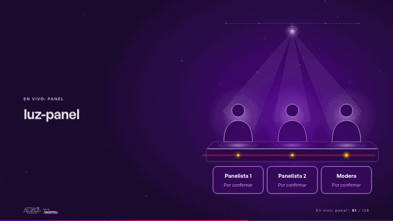
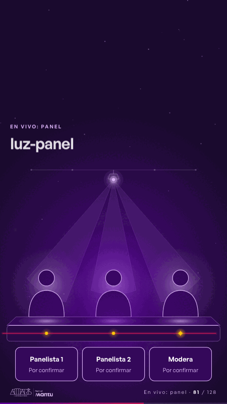

# luz-panel · En vivo: panel

 

## Qué cuenta

Una mesa de luz en perspectiva con tres siluetas sin rostro sentadas detrás y una lámpara en su riel arriba; frente a cada una, una tarjeta con su rol y «Por confirmar»; el trazo magenta cruza el frente de la mesa.

## Cómo respira

Un foco baja de la lámpara y se detiene en cada persona, como en su presentación de 20 segundos, mientras la chispa del trazo llega a su puesto; cada silueta, su charco de luz sobre la mesa, su punto y su tarjeta se encienden y quedan encendidos bajo un cono suave. Cuadro final: las tres siluetas encendidas bajo su luz, cada tarjeta legible con su rol y «Por confirmar».

## Cuándo usarla

Intención: **En vivo: panel** (panel). Verticales: cualquiera. Layout `left`; mundo luz. Origen: webinar «IA: ¿el fin del piloto eterno?» · diapositiva «Panel». El snippet completo, listo para pegar en un storyboard: [`snippets/luz-panel.json`](../../snippets/luz-panel.json).

## Args

```json
{
 "layout": "left",
 "scene": "luz-panel",
 "args": {
  "seats": [
   [
    "‹como: Panelista 1›",
    "‹como: Por confirmar›"
   ],
   [
    "‹como: Panelista 2›",
    "‹como: Por confirmar›"
   ],
   [
    "‹como: Modera›",
    "‹como: Por confirmar›"
   ]
  ]
 }
}
```

## What it is

Live: panel scene, layout «left», for any decks. It lands at a glance, then breathes in a slow loop; its args (seats) carry every visible word, so the same scene serves a new client once the texts are rewritten.

## Relacionadas · Related

- [panel-questions · En vivo: panel](panel-questions.md)
- [panel-questions-list · En vivo: panel](panel-questions-list.md)

Fuente · source: [`scenes/story/webinar_s01_15.py`](../../scenes/story/webinar_s01_15.py) · sha256 `32ce7205f2f7`
