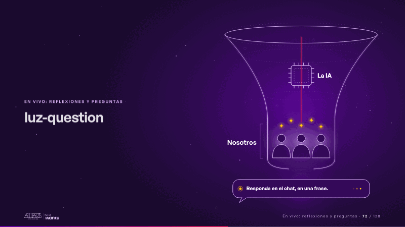
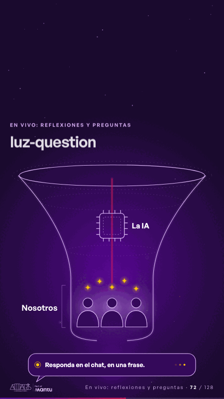

# luz-question · En vivo: reflexiones y preguntas

 

## Qué cuenta

Un embudo de luz en profundidad (su boca, dos cortes y una pared que se estrecha): arriba, el chip «La IA», abierto sobre la estela; abajo, el cuello «Nosotros» alrededor de tres personas sin rostro; debajo, la burbuja del chat.

## Cómo respira

Cinco chispas caen al embudo una tras otra, cruzan el chip sin frenarse (el chip destella a cada paso) y se quedan flotando, curiosas, sobre las personas, que se encienden al llegarles la luz; el cuello respira y una chispa más sigue de largo, pasa por detrás de la persona del centro y cae en la burbuja del chat, que se enciende y empieza a escribir. Cuadro final: el chip despejado, cinco chispas sobre las personas encendidas y la burbuja encendida.

## Cuándo usarla

Intención: **En vivo: reflexiones y preguntas** (reflection). Verticales: cualquiera. Layout `left`; mundo luz. Origen: webinar «IA: ¿el fin del piloto eterno?» · diapositiva «¿El cuello de botella es la IA… o somos nosotros?». El snippet completo, listo para pegar en un storyboard: [`snippets/luz-question.json`](../../snippets/luz-question.json).

## Args

```json
{
 "layout": "left",
 "scene": "luz-question",
 "args": {
  "chip": "‹como: La IA›",
  "neck": "‹como: Nosotros›",
  "chat": "‹como: Responda en el chat, en una frase.›"
 }
}
```

## What it is

Live: reflections and questions scene, layout «left», for any decks. It lands at a glance, then breathes in a slow loop; its args (chat, chip, neck) carry every visible word, so the same scene serves a new client once the texts are rewritten.

## Relacionadas · Related

- [chain-tap · Diseño técnico por capas](chain-tap.md)
- [reflections-cards · En vivo: reflexiones y preguntas](reflections-cards.md)
- [reflections-live · En vivo: reflexiones y preguntas](reflections-live.md)
- [time-back · En vivo: reflexiones y preguntas](time-back.md)
- [time-freed · En vivo: reflexiones y preguntas](time-freed.md)
- [unfold-describe · En vivo: reflexiones y preguntas](unfold-describe.md)

Fuente · source: [`scenes/story/webinar_s01_15.py`](../../scenes/story/webinar_s01_15.py) · sha256 `32ce7205f2f7`
