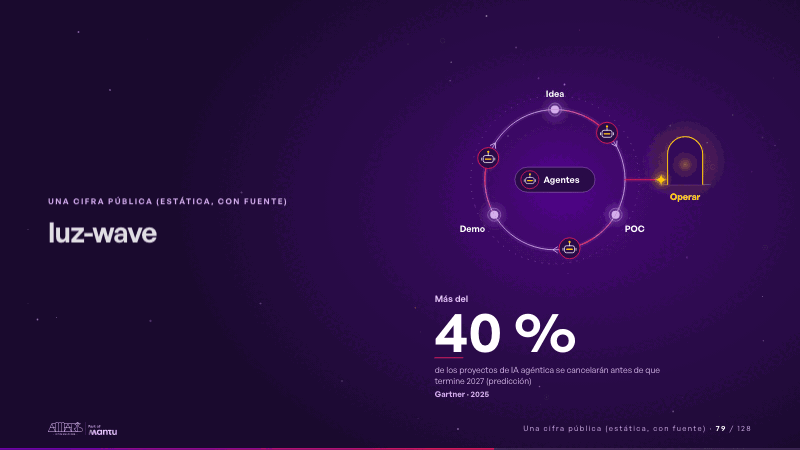
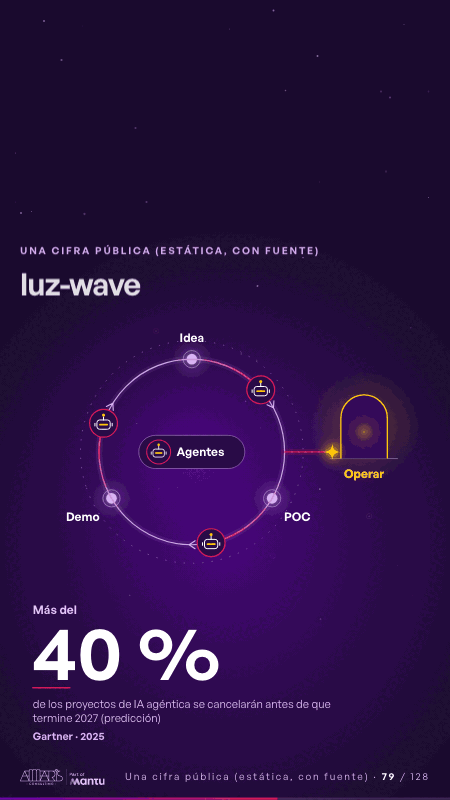

# luz-wave · Una cifra pública (estática, con fuente)

 

## Qué cuenta

El mismo anillo Idea → POC → Demo de la diapositiva 5, ahora con tres agentes visibles (un pequeño robot de luz en cada uno) girando en él y la leyenda «Agentes» al centro; afuera, la puerta «Operar» apagada; abajo, la cifra quieta y grande: más del 40 %, con su alcance y su fuente.

## Cómo respira

Los tres agentes dan vueltas al anillo con su estela, como antes la chispa, y encienden cada parada al pasar; a los 3,5 s, cuando un agente pasa frente a la salida, una chispa se desprende y avanza dibujando el trazo magenta; a los 6 s llega al umbral, «Operar» se enciende con un anillo de luz y la chispa espera ahí, respirando: la pregunta queda abierta. La cifra no se mueve. Cuadro final: el anillo con sus agentes, la chispa en el umbral de «Operar» encendido y el 40 % quieto con su fuente.

## Cuándo usarla

Intención: **Una cifra pública (estática, con fuente)** (figure). Verticales: cualquiera. Layout `left`; mundo luz. Origen: webinar «IA: ¿el fin del piloto eterno?» · diapositiva «La próxima ola: ¿escala o repite el ciclo?». El snippet completo, listo para pegar en un storyboard: [`snippets/luz-wave.json`](../../snippets/luz-wave.json).

## Args

```json
{
 "layout": "left",
 "scene": "luz-wave",
 "args": {
  "stops": [
   "‹como: Idea›",
   "‹como: POC›",
   "‹como: Demo›"
  ],
  "exit": "‹como: Operar›",
  "agents": "‹como: Agentes›",
  "figure": [
   {
    "pre": "‹como: Más del›",
    "v": "‹como: 40 %›",
    "label": "‹como: de los proyectos de IA agéntica se cancelarán antes de que termine 2027 (predicción)›",
    "src": "‹como: Gartner · 2025›"
   }
  ]
 }
}
```

## What it is

A public figure, static and sourced scene, layout «left», for any decks. It lands at a glance, then breathes in a slow loop; its args (agents, exit, figure, stops) carry every visible word, so the same scene serves a new client once the texts are rewritten.

## Relacionadas · Related

- [cost-drop · Una cifra pública (estática, con fuente)](cost-drop.md)
- [evidence · La prueba y la evidencia](evidence.md)
- [figure-context · Una cifra pública (estática, con fuente)](figure-context.md)
- [figure-door · Una cifra pública (estática, con fuente)](figure-door.md)
- [figure-growth · Una cifra pública (estática, con fuente)](figure-growth.md)
- [figure-rank · Una cifra pública (estática, con fuente)](figure-rank.md)

Fuente · source: [`scenes/story/webinar_s01_15.py`](../../scenes/story/webinar_s01_15.py) · sha256 `32ce7205f2f7`
