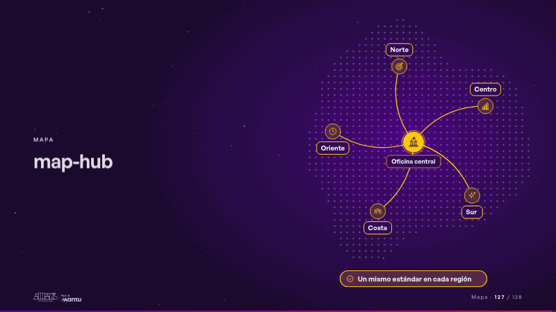
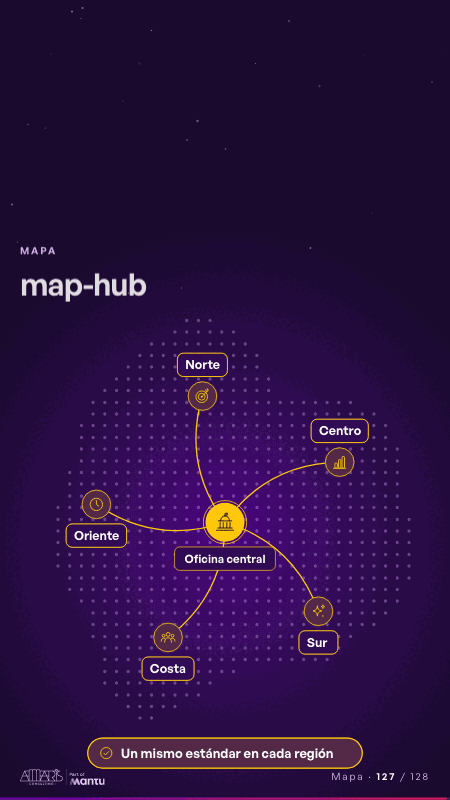

# map-hub · Mapa

 

## Qué cuenta

Una tierra abstracta de puntos (nunca un mapa real), su oficina central al medio y cinco regiones con un ícono de su sector y su nombre; abajo, la nota.

## Cómo respira

Una línea sale de la central a cada región, una ficha la recorre y la región se enciende; con todas unidas se enciende la nota. Queda: las cinco regiones unidas a la central.

## Cuándo usarla

Intención: **Mapa** (map, governance). Verticales: cualquiera. Layout `left`. Origen: dcd 0.6.0 · escena de catálogo. El snippet completo, listo para pegar en un storyboard: [`snippets/map-hub.json`](../../snippets/map-hub.json).

## Args

```json
{
 "layout": "left",
 "scene": "map-hub",
 "args": {
  "hub": "‹como: Oficina central›",
  "regions": [
   "‹como: Norte›",
   "‹como: Centro›",
   "‹como: Sur›",
   "‹como: Costa›",
   "‹como: Oriente›"
  ],
  "note": "‹como: Un mismo estándar en cada región›"
 }
}
```

## What it is

Map scene, layout «left», for any decks. It lands at a glance, then breathes in a slow loop; its args (hub, note, regions) carry every visible word, so the same scene serves a new client once the texts are rewritten.

## Relacionadas · Related

- [data-architecture · Diseño técnico por capas](data-architecture.md)
- [data-lifecycle · Lo que sus equipos comparten: el dato](data-lifecycle.md)
- [facts-columns · Lo que sus equipos comparten: el dato](facts-columns.md)
- [federated-live · Gobierno, permisos y control](federated-live.md)
- [infra-topology · Diseño técnico por capas](infra-topology.md)
- [knowledge-spaces · Gobierno, permisos y control](knowledge-spaces.md)

Fuente · source: [`scenes/story/intents_s09_16.py`](../../scenes/story/intents_s09_16.py) · sha256 `cf63c5919182`
