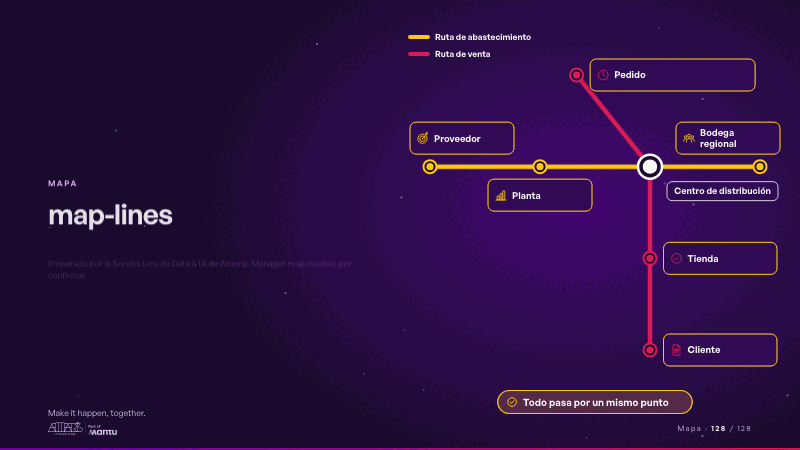
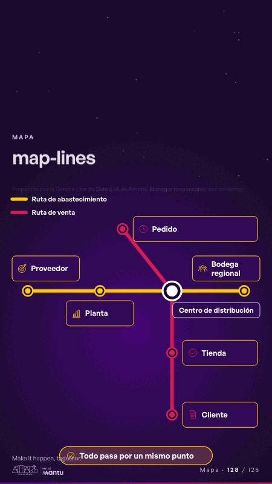

# map-lines · Mapa

 

## Qué cuenta

Dos rutas dibujadas como un mapa de transporte, una a lo ancho y otra hacia abajo, con sus paradas e íconos de su sector; se cruzan en una estación compartida.

## Cómo respira

La primera ruta se enciende parada a parada, luego la segunda, con una ficha en cada una; al final la estación compartida se enciende con la nota. Queda: las dos rutas encendidas y el cruce en su centro.

## Cuándo usarla

Intención: **Mapa** (map, process, data). Verticales: cualquiera. Layout `left`. Origen: dcd 0.6.0 · escena de catálogo. El snippet completo, listo para pegar en un storyboard: [`snippets/map-lines.json`](../../snippets/map-lines.json).

## Args

```json
{
 "layout": "left",
 "scene": "map-lines",
 "args": {
  "routes": [
   {
    "name": "‹como: Ruta de abastecimiento›",
    "stops": [
     "‹como: Proveedor›",
     "‹como: Planta›",
     "‹como: Centro de distribución›",
     "‹como: Bodega regional›"
    ]
   },
   {
    "name": "‹como: Ruta de venta›",
    "stops": [
     "‹como: Pedido›",
     "‹como: Centro de distribución›",
     "‹como: Tienda›",
     "‹como: Cliente›"
    ]
   }
  ],
  "hub": "‹como: Centro de distribución›",
  "note": "‹como: Todo pasa por un mismo punto›"
 }
}
```

## What it is

Map scene, layout «left», for any decks. It lands at a glance, then breathes in a slow loop; its args (hub, note, routes) carry every visible word, so the same scene serves a new client once the texts are rewritten.

## Relacionadas · Related

- [mechanism · El mecanismo: cómo cambiaría su operación](mechanism.md)
- [mechanism-teams · El mecanismo: cómo cambiaría su operación](mechanism-teams.md)
- [automation-stairs · El mecanismo: cómo cambiaría su operación](automation-stairs.md)
- [before-after-lanes · Antes y después](before-after-lanes.md)
- [before-after-split · Antes y después](before-after-split.md)
- [build-deliver · Formación: la demo en vivo](build-deliver.md)

Fuente · source: [`scenes/story/intents_s09_16.py`](../../scenes/story/intents_s09_16.py) · sha256 `cf63c5919182`
