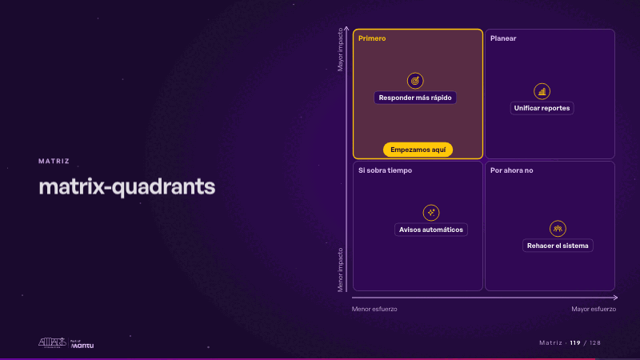
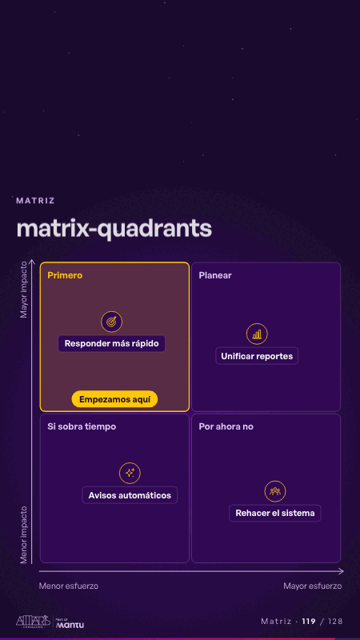

# matrix-quadrants · Matriz

 

## Qué cuenta

Una matriz de dos por dos, esfuerzo a lo ancho e impacto a lo alto, con sus cuatro cuadrantes nombrados.

## Cómo respira

Las ideas caen una a una a su lugar con su ícono y su nombre (posiciones relativas, no medidas); al final el cuadrante de mayor impacto y menor esfuerzo se enciende con «Empezamos aquí». Queda: las ideas ubicadas y el primer cuadrante encendido.

## Cuándo usarla

Intención: **Matriz** (matrix, criterion, hypotheses). Verticales: cualquiera. Layout `left`. Origen: dcd 0.6.0 · escena de catálogo. El snippet completo, listo para pegar en un storyboard: [`snippets/matrix-quadrants.json`](../../snippets/matrix-quadrants.json).

## Args

```json
{
 "layout": "left",
 "scene": "matrix-quadrants",
 "args": {
  "x_axis": [
   "‹como: Menor esfuerzo›",
   "‹como: Mayor esfuerzo›"
  ],
  "y_axis": [
   "‹como: Menor impacto›",
   "‹como: Mayor impacto›"
  ],
  "quadrants": [
   "‹como: Primero›",
   "‹como: Planear›",
   "‹como: Si sobra tiempo›",
   "‹como: Por ahora no›"
  ],
  "ideas": [
   [
    "‹como: Responder más rápido›",
    0.24,
    0.8
   ],
   [
    "‹como: Unificar reportes›",
    0.72,
    0.76
   ],
   [
    "‹como: Avisos automáticos›",
    0.3,
    0.3
   ],
   [
    "‹como: Rehacer el sistema›",
    0.78,
    0.24
   ]
  ],
  "pick": "‹como: Empezamos aquí›"
 }
}
```

## What it is

Matrix scene, layout «left», for any decks. It lands at a glance, then breathes in a slow loop; its args (ideas, pick, quadrants, x_axis, y_axis) carry every visible word, so the same scene serves a new client once the texts are rewritten.

## Relacionadas · Related

- [funnel-gates · Embudo](funnel-gates.md)
- [matrix-table · Matriz](matrix-table.md)
- [adr-decisions · Diseño técnico por capas](adr-decisions.md)
- [criterion · El criterio: retorno o habilitador](criterion.md)
- [criterion-b · El criterio: retorno o habilitador](criterion-b.md)
- [funnel-weeks · Hipótesis por validar](funnel-weeks.md)

Fuente · source: [`scenes/story/intents_s01_08.py`](../../scenes/story/intents_s01_08.py) · sha256 `40167e45ae96`
