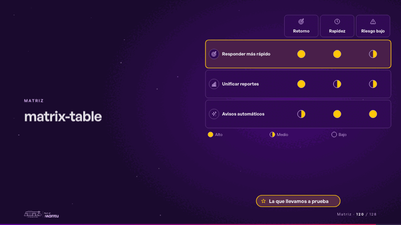
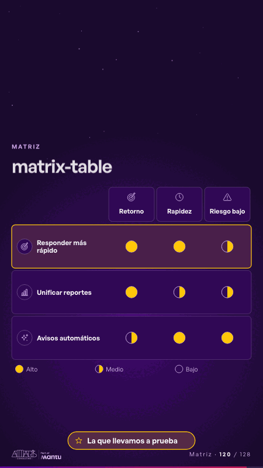

# matrix-table · Matriz

 

## Qué cuenta

Una tabla: tres opciones con el ícono de su sector en las filas, tres criterios en las columnas y sus círculos vacíos; debajo, la leyenda.

## Cómo respira

Las marcas se llenan columna por columna (lleno, medio o vacío; nunca una cifra) y al final la fila elegida se enciende con su etiqueta. Queda: la tabla completa y la opción elegida.

## Cuándo usarla

Intención: **Matriz** (matrix, criterion). Verticales: cualquiera. Layout `left`. Origen: dcd 0.6.0 · escena de catálogo. El snippet completo, listo para pegar en un storyboard: [`snippets/matrix-table.json`](../../snippets/matrix-table.json).

## Args

```json
{
 "layout": "left",
 "scene": "matrix-table",
 "args": {
  "criteria": [
   "‹como: Retorno›",
   "‹como: Rapidez›",
   "‹como: Riesgo bajo›"
  ],
  "rows": [
   "‹como: Responder más rápido›",
   "‹como: Unificar reportes›",
   "‹como: Avisos automáticos›"
  ],
  "marks": [
   [
    2,
    2,
    1
   ],
   [
    2,
    1,
    1
   ],
   [
    1,
    2,
    2
   ]
  ],
  "pick": 0,
  "pick_label": "‹como: La que llevamos a prueba›",
  "legend": [
   "‹como: Alto›",
   "‹como: Medio›",
   "‹como: Bajo›"
  ]
 }
}
```

## What it is

Matrix scene, layout «left», for any decks. It lands at a glance, then breathes in a slow loop; its args (criteria, legend, marks, pick, pick_label, rows) carry every visible word, so the same scene serves a new client once the texts are rewritten.

## Relacionadas · Related

- [matrix-quadrants · Matriz](matrix-quadrants.md)
- [adr-decisions · Diseño técnico por capas](adr-decisions.md)
- [criterion · El criterio: retorno o habilitador](criterion.md)
- [criterion-b · El criterio: retorno o habilitador](criterion-b.md)
- [funnel-gates · Embudo](funnel-gates.md)
- [luz-escala · El criterio: retorno o habilitador](luz-escala.md)

Fuente · source: [`scenes/story/intents_s01_08.py`](../../scenes/story/intents_s01_08.py) · sha256 `40167e45ae96`
