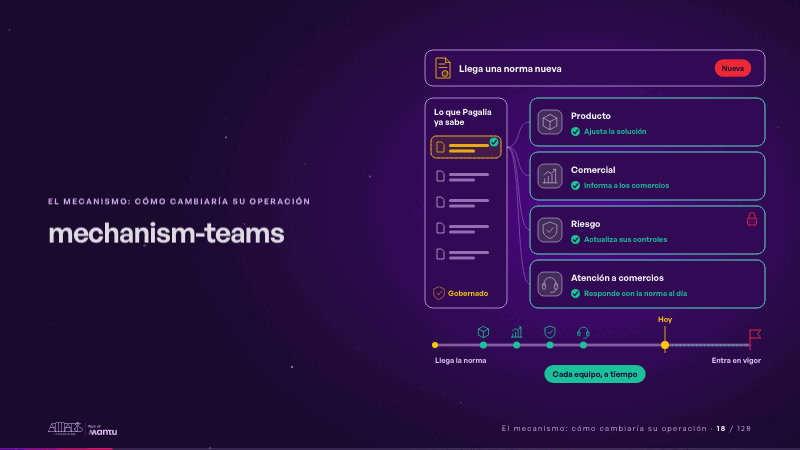
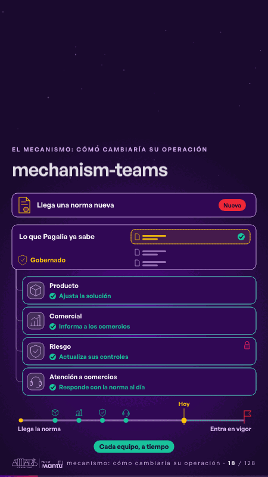

# mechanism-teams · El mecanismo: cómo cambiaría su operación

 

## Qué cuenta

De arriba abajo: la norma nueva, lo que Pagalia ya sabe, los cuatro equipos (producto, comercial, riesgo y atención a comercios) y la línea del tiempo hasta que la norma entra en vigor.

## Cómo respira

La norma cae en lo que la compañía sabe; cada equipo recibe en su espacio su propia respuesta y decide, y cada decisión cae en la línea mucho antes de la fecha.

## Cuándo usarla

Intención: **El mecanismo: cómo cambiaría su operación** (process, data). Verticales: pagos, cualquiera. Layout `left`. Origen: dcd · escena de catálogo (pagos). El snippet completo, listo para pegar en un storyboard: [`snippets/mechanism-teams.json`](../../snippets/mechanism-teams.json).

## Args

```json
{
 "layout": "left",
 "scene": "mechanism-teams",
 "args": {
  "event": "‹como: Llega una norma nueva›",
  "new": "‹como: Nueva›",
  "center": "‹como: Lo que Pagalia ya sabe›",
  "governed": "‹como: Gobernado›",
  "teams": [
   "‹como: Producto›",
   "‹como: Comercial›",
   "‹como: Riesgo›",
   "‹como: Atención a comercios›"
  ],
  "questions": [
   "‹como: ¿Qué cambia en la solución?›",
   "‹como: ¿Qué les decimos a los comercios?›",
   "‹como: ¿Qué control aplica?›",
   "‹como: ¿Cómo respondo la consulta?›"
  ],
  "answers": [
   "‹como: Ajusta la solución›",
   "‹como: Informa a los comercios›",
   "‹como: Actualiza sus controles›",
   "‹como: Responde con la norma al día›"
  ],
  "start": "‹como: Llega la norma›",
  "due": "‹como: Entra en vigor›",
  "now": "‹como: Hoy›",
  "done": "‹como: Cada equipo, a tiempo›"
 }
}
```

## What it is

The mechanism scene, layout «left», for pagos, any decks. It lands at a glance, then breathes in a slow loop; its args (answers, center, done, due, event, governed, new, now, questions, start, teams) carry every visible word, so the same scene serves a new client once the texts are rewritten.

## Relacionadas · Related

- [hypotheses-live-b · Hipótesis por validar](hypotheses-live-b.md)
- [repeat-story · La brecha: su idea y lo que pasa cuando no se cumple](repeat-story.md)
- [tickets-live · Cierre: su futuro, funcionando (el lema)](tickets-live.md)
- [discovery · Próximo paso: formas de empezar y discovery](discovery.md)
- [map-lines · Mapa](map-lines.md)
- [mechanism · El mecanismo: cómo cambiaría su operación](mechanism.md)

Fuente · source: [`scenes/story/pagos_s01_03.py`](../../scenes/story/pagos_s01_03.py) · sha256 `826293d2c8e4`
