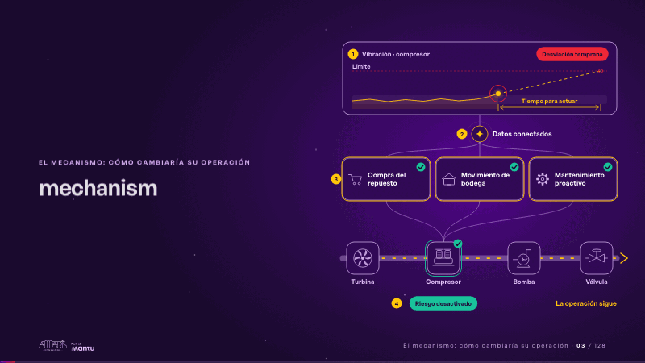
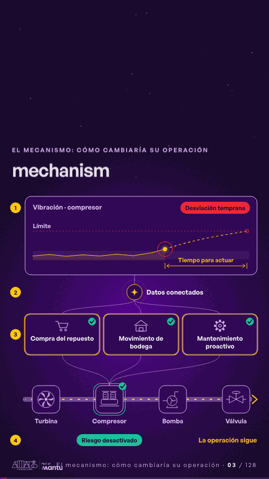

# mechanism · El mecanismo: cómo cambiaría su operación

 

## Qué cuenta

De arriba abajo, la cadena en cuatro pasos: la vibración del compresor, los datos conectados, tres decisiones de negocio y la línea con sus cuatro estaciones.

## Cómo respira

La vibración sale de su rango mucho antes del límite, la señal llega a compras, bodega y mantenimiento, cada decisión se marca y la respuesta baja al compresor, que pasa a verde mientras la línea sigue.

## Cuándo usarla

Intención: **El mecanismo: cómo cambiaría su operación** (process, data). Verticales: energia. Layout `left`. Origen: dcd · escena de catálogo (energía). El snippet completo, listo para pegar en un storyboard: [`snippets/mechanism.json`](../../snippets/mechanism.json).

## Args

```json
{
 "layout": "left",
 "scene": "mechanism",
 "args": {
  "chart": "‹como: Vibración · compresor›",
  "limit": "‹como: Límite›",
  "deviation": "‹como: Desviación temprana›",
  "margin": "‹como: Tiempo para actuar›",
  "link": "‹como: Datos conectados›",
  "decisions": [
   "‹como: Compra del repuesto›",
   "‹como: Movimiento de bodega›",
   "‹como: Mantenimiento proactivo›"
  ],
  "stations": [
   "‹como: Turbina›",
   "‹como: Compresor›",
   "‹como: Bomba›",
   "‹como: Válvula›"
  ],
  "done": "‹como: Riesgo desactivado›",
  "sign": "‹como: La operación sigue›"
 }
}
```

## What it is

The mechanism scene, layout «left», for energia decks. It lands at a glance, then breathes in a slow loop; its args (chart, decisions, deviation, done, limit, link, margin, sign, stations) carry every visible word, so the same scene serves a new client once the texts are rewritten.

## Relacionadas · Related

- [cascade · La brecha: su idea y lo que pasa cuando no se cumple](cascade.md)
- [hypotheses-live · Hipótesis por validar](hypotheses-live.md)
- [discovery · Próximo paso: formas de empezar y discovery](discovery.md)
- [map-lines · Mapa](map-lines.md)
- [mechanism-teams · El mecanismo: cómo cambiaría su operación](mechanism-teams.md)
- [controlroom-live · Cierre: su futuro, funcionando (el lema)](controlroom-live.md)

Fuente · source: [`scenes/story/energia_s01_03.py`](../../scenes/story/energia_s01_03.py) · sha256 `6ec42dd92e1d`
