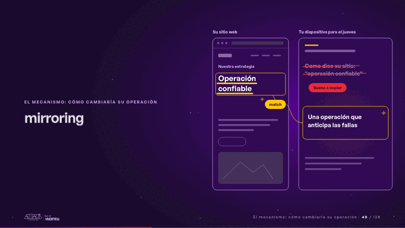
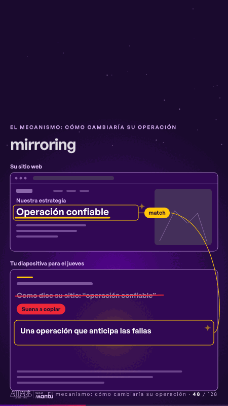

# mirroring · El mecanismo: cómo cambiaría su operación

 

## Qué cuenta

A la izquierda, su sitio web con su frase «Operación confiable»; a la derecha, tu diapositiva para el jueves, aún vacía.

## Cómo respira

La frase del cliente se subraya y pasa tal cual a tu diapositiva, entre comillas; se tacha con «Suena a copiar», se reescribe como «Una operación que anticipa las fallas» y un hilo con «match» la une a la frase del cliente.

## Cuándo usarla

Intención: **El mecanismo: cómo cambiaría su operación** (process). Verticales: formacion. Layout `left`. Origen: Clase VR (formación) · diapositiva «Usa su vocabulario, pero no le leas sus frases». El snippet completo, listo para pegar en un storyboard: [`snippets/mirroring.json`](../../snippets/mirroring.json).

## Args

```json
{
 "layout": "left",
 "scene": "mirroring",
 "args": {
  "source": "‹como: Su sitio web›",
  "section": "‹como: Nuestra estrategia›",
  "phrase": "‹como: Operación confiable›",
  "draft": "‹como: Tu diapositiva para el jueves›",
  "copied": "‹como: Como dice su sitio: “operación confiable”›",
  "copy_tag": "‹como: Suena a copiar›",
  "ours": "‹como: Una operación que anticipa las fallas›",
  "match": "‹como: match›"
 }
}
```

## What it is

The mechanism scene, layout «left», for formacion decks. It lands at a glance, then breathes in a slow loop; its args (copied, copy_tag, draft, match, ours, phrase, section, source) carry every visible word, so the same scene serves a new client once the texts are rewritten.

## Relacionadas · Related

- [week-calendar · La brecha: su idea y lo que pasa cuando no se cumple](week-calendar.md)
- [hypotheses-live · Hipótesis por validar](hypotheses-live.md)
- [discovery · Próximo paso: formas de empezar y discovery](discovery.md)
- [build-deliver · Formación: la demo en vivo](build-deliver.md)
- [lema-conversation · Cierre: su futuro, funcionando (el lema)](lema-conversation.md)
- [live-steps · Formación: la demo en vivo](live-steps.md)

Fuente · source: [`scenes/story/formacion_s07_09.py`](../../scenes/story/formacion_s07_09.py) · sha256 `a7068cdfb5bb`
