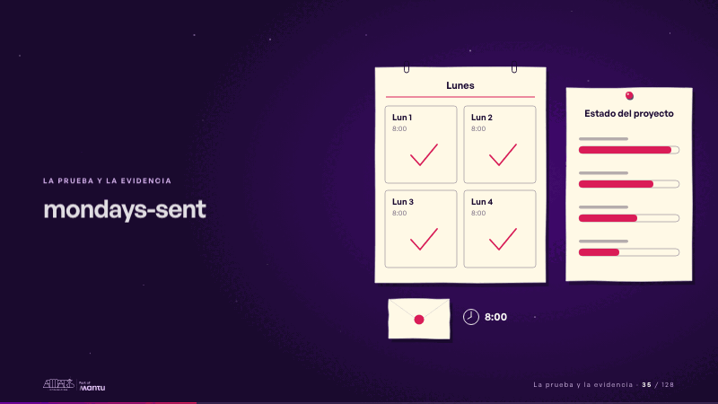
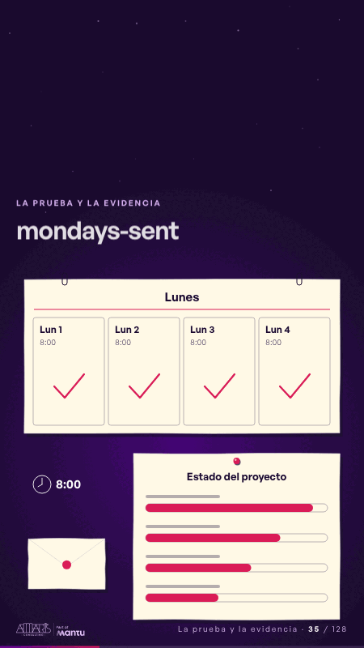

# mondays-sent · La prueba y la evidencia

 

## Qué cuenta

El calendario de papel con cuatro lunes, el tablero de estado vacío y el sobre sellado listo para salir.

## Cómo respira

A las 8:00 el sobre sale volando al tablero, el primer lunes recibe su visto y aparece una barra; vuelve sellado y se repite el segundo, el tercero y el cuarto lunes. Cuadro final: cuatro lunes con visto y el tablero completo.

## Cuándo usarla

Intención: **La prueba y la evidencia** (proof, kpi). Verticales: cualquiera. Layout `left`; mundo papel. Origen: dcd · escena de catálogo (fidelización). El snippet completo, listo para pegar en un storyboard: [`snippets/mondays-sent.json`](../../snippets/mondays-sent.json).

## Args

```json
{
 "layout": "left",
 "scene": "mondays-sent",
 "args": {
  "mondays": [
   "‹como: Lun 1›",
   "‹como: Lun 2›",
   "‹como: Lun 3›",
   "‹como: Lun 4›"
  ],
  "hour": "‹como: 8:00›",
  "calendar": "‹como: Lunes›",
  "board": "‹como: Estado del proyecto›"
 }
}
```

## What it is

Proof and evidence scene, layout «left», for any decks. It lands at a glance, then breathes in a slow loop; its args (board, calendar, hour, mondays) carry every visible word, so the same scene serves a new client once the texts are rewritten.

## Relacionadas · Related

- [review-lens · Gobierno, permisos y control](review-lens.md)
- [discovery · Próximo paso: formas de empezar y discovery](discovery.md)
- [hypotheses-live · Hipótesis por validar](hypotheses-live.md)
- [lema-signer · Cierre: su futuro, funcionando (el lema)](lema-signer.md)
- [paper-hero · Portada: su promesa](paper-hero.md)
- [pinned-request · La brecha: su idea y lo que pasa cuando no se cumple](pinned-request.md)

Fuente · source: [`scenes/story/fidelizacion_s01_15.py`](../../scenes/story/fidelizacion_s01_15.py) · sha256 `c89653556c57`
