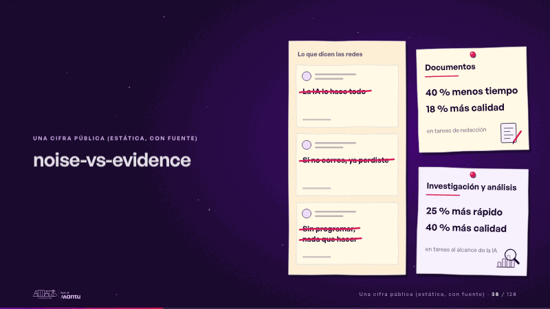
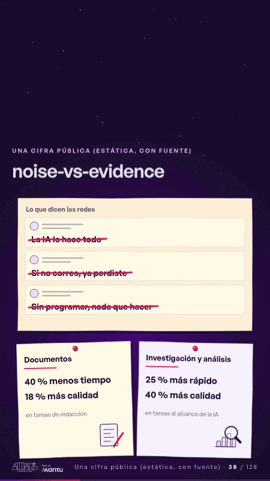

# noise-vs-evidence · Una cifra pública (estática, con fuente)

 

## Qué cuenta

Un feed de papel con tres publicaciones exageradas a la izquierda y dos notas a la derecha, cada una con sus cifras fijas.

## Cómo respira

La cinta magenta tacha las publicaciones del feed una a una y quedan tachadas; luego cada nota recibe su chincheta: documentos (40 % menos tiempo, 18 % más calidad) e investigación y análisis (25 % más rápido, 40 % más calidad). Cuadro final: feed tachado, dos notas clavadas.

## Cuándo usarla

Intención: **Una cifra pública (estática, con fuente)** (figure, proof). Verticales: cualquiera. Layout `left`; mundo papel. Origen: dcd · escena de catálogo (fidelización). El snippet completo, listo para pegar en un storyboard: [`snippets/noise-vs-evidence.json`](../../snippets/noise-vs-evidence.json).

## Args

```json
{
 "layout": "left",
 "scene": "noise-vs-evidence",
 "args": {
  "feed": "‹como: Lo que dicen las redes›",
  "posts": [
   "‹como: La IA lo hace todo›",
   "‹como: Si no corres, ya perdiste›",
   "‹como: Sin programar, nada que hacer›"
  ],
  "figure": "‹como: 40 % menos tiempo›",
  "cards": [
   {
    "title": "‹como: Documentos›",
    "lines": [
     "‹como: 40 % menos tiempo›",
     "‹como: 18 % más calidad›"
    ],
    "small": "‹como: en tareas de redacción›"
   },
   {
    "title": "‹como: Investigación y análisis›",
    "lines": [
     "‹como: 25 % más rápido›",
     "‹como: 40 % más calidad›"
    ],
    "small": "‹como: en tareas al alcance de la IA›"
   }
  ]
 }
}
```

## What it is

A public figure, static and sourced scene, layout «left», for any decks. It lands at a glance, then breathes in a slow loop; its args (cards, feed, figure, posts) carry every visible word, so the same scene serves a new client once the texts are rewritten.

## Relacionadas · Related

- [evidence · La prueba y la evidencia](evidence.md)
- [capacity-join · La prueba y la evidencia](capacity-join.md)
- [cost-drop · Una cifra pública (estática, con fuente)](cost-drop.md)
- [delivery-cycle · El mecanismo: cómo cambiaría su operación](delivery-cycle.md)
- [figure-context · Una cifra pública (estática, con fuente)](figure-context.md)
- [figure-door · Una cifra pública (estática, con fuente)](figure-door.md)

Fuente · source: [`scenes/story/fidelizacion_s01_15.py`](../../scenes/story/fidelizacion_s01_15.py) · sha256 `c89653556c57`
