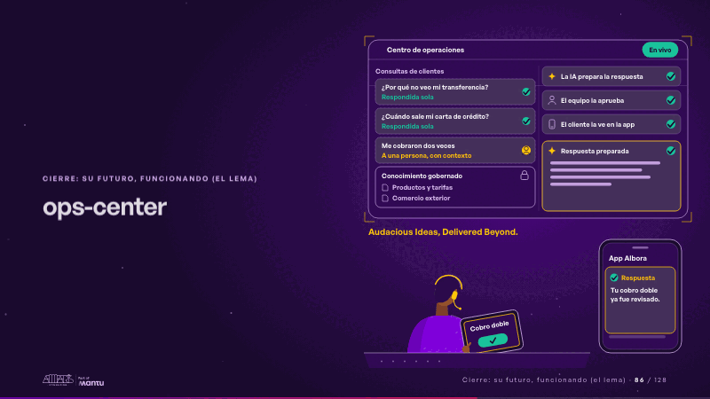
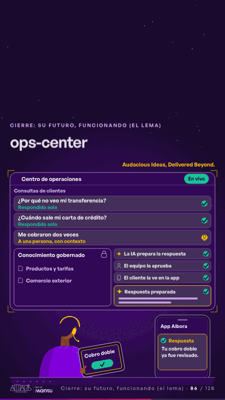

# ops-center · Cierre: su futuro, funcionando (el lema)

 

## Qué cuenta

El centro de operaciones de mañana, en vivo: a la izquierda, la cola de consultas y el conocimiento gobernado; a la derecha, los tres pasos de una respuesta; debajo, el teléfono del cliente y una persona del equipo con su tablet.

## Cómo respira

Llegan tres consultas: las dos primeras se responden solas desde el conocimiento gobernado; la tercera se vuelve sensible y baja a la persona con su contexto; la IA prepara la respuesta, el equipo la aprueba en la tablet y el cliente la ve en la app.

## Cuándo usarla

Intención: **Cierre: su futuro, funcionando (el lema)** (vision, governance). Verticales: banca. Layout `left`. Origen: dcd · escena de catálogo (banca). El snippet completo, listo para pegar en un storyboard: [`snippets/ops-center.json`](../../snippets/ops-center.json).

## Args

```json
{
 "layout": "left",
 "scene": "ops-center",
 "args": {
  "screen": "‹como: Centro de operaciones›",
  "live": "‹como: En vivo›",
  "queue": "‹como: Consultas de clientes›",
  "tickets": [
   "‹como: ¿Por qué no veo mi transferencia?›",
   "‹como: ¿Cuándo sale mi carta de crédito?›",
   "‹como: Me cobraron dos veces›"
  ],
  "new": "‹como: Nuevo›",
  "solved": "‹como: Respondida sola›",
  "sensitive": "‹como: Sensible›",
  "routed": "‹como: A una persona, con contexto›",
  "space": "‹como: Conocimiento gobernado›",
  "docs": [
   "‹como: Productos y tarifas›",
   "‹como: Comercio exterior›"
  ],
  "phases": [
   "‹como: La IA prepara la respuesta›",
   "‹como: El equipo la aprueba›",
   "‹como: El cliente la ve en la app›"
  ],
  "draft": "‹como: Respuesta preparada›",
  "app": "‹como: App Albora›",
  "note": [
   "‹como: Respuesta›",
   "‹como: Tu cobro doble ya fue revisado.›"
  ],
  "case": "‹como: Cobro doble›",
  "approve": "‹como: Aprobar›",
  "sign": "‹como: Audacious Ideas, Delivered Beyond.›"
 }
}
```

## What it is

Closing: their future, working scene, layout «left», for banca decks. It lands at a glance, then breathes in a slow loop; its args (app, approve, case, docs, draft, live, new, note, phases, queue, routed, screen, sensitive, sign, solved, space, tickets) carry every visible word, so the same scene…

## Relacionadas · Related

- [discovery · Próximo paso: formas de empezar y discovery](discovery.md)
- [hero-bank · Portada: su promesa](hero-bank.md)
- [hypotheses-bank · Hipótesis por validar](hypotheses-bank.md)
- [repeat-story · La brecha: su idea y lo que pasa cuando no se cumple](repeat-story.md)
- [criterion · El criterio: retorno o habilitador](criterion.md)
- [outside-business · Desde afuera: lo que vimos en fuentes públicas](outside-business.md)

Fuente · source: [`scenes/story/banca_s01_14.py`](../../scenes/story/banca_s01_14.py) · sha256 `f268b7f9fd00`
