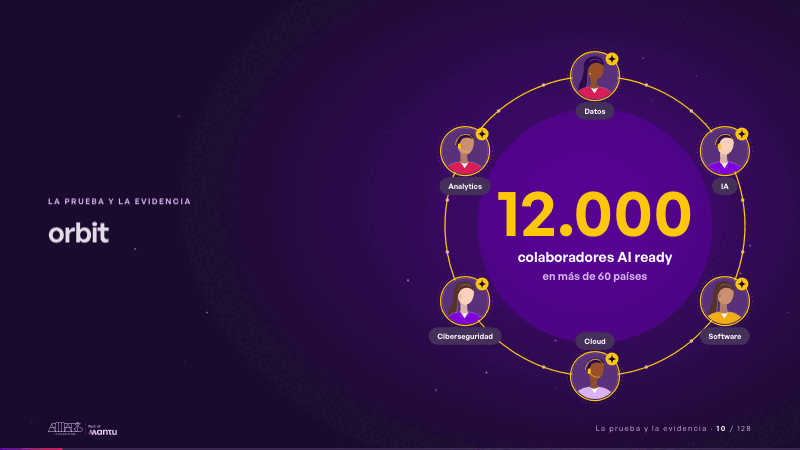
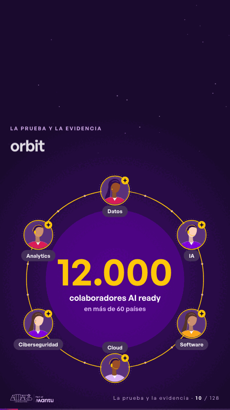

# orbit · La prueba y la evidencia

 

## Qué cuenta

La cifra 12.000 aparece quieta en el centro de la órbita y, sobre ella, seis colegas sin rostro, cada uno con su disciplina: datos, IA, software, cloud, ciberseguridad y analytics.

## Cómo respira

Una chispa de IA recorre la órbita y llega a cada colega, que se enciende con su chispa, mientras su estela los une y el halo de la cifra crece hasta cerrar el anillo con los seis aumentados y conectados.

## Cuándo usarla

Intención: **La prueba y la evidencia** (proof, who). Verticales: cualquiera. Layout `left`. Origen: dcd · escena de catálogo (energía). El snippet completo, listo para pegar en un storyboard: [`snippets/orbit.json`](../../snippets/orbit.json).

## Args

```json
{
 "layout": "left",
 "scene": "orbit",
 "args": {
  "figure": "‹como: 12.000›",
  "label": "‹como: colaboradores AI ready›",
  "reach": "‹como: en más de 60 países›",
  "roles": [
   "‹como: Datos›",
   "‹como: IA›",
   "‹como: Software›",
   "‹como: Cloud›",
   "‹como: Ciberseguridad›",
   "‹como: Analytics›"
  ]
 }
}
```

## What it is

Proof and evidence scene, layout «left», for any decks. It lands at a glance, then breathes in a slow loop; its args (figure, label, reach, roles) carry every visible word, so the same scene serves a new client once the texts are rewritten.

## Relacionadas · Related

- [internal-case · La prueba y la evidencia](internal-case.md)
- [capacity-join · La prueba y la evidencia](capacity-join.md)
- [delivery-cycle · El mecanismo: cómo cambiaría su operación](delivery-cycle.md)
- [evidence · La prueba y la evidencia](evidence.md)
- [kpi-card · KPI y casos de éxito](kpi-card.md)
- [mondays-sent · La prueba y la evidencia](mondays-sent.md)

Fuente · source: [`scenes/story/energia_s10_12.py`](../../scenes/story/energia_s10_12.py) · sha256 `4d67c9a61598`
