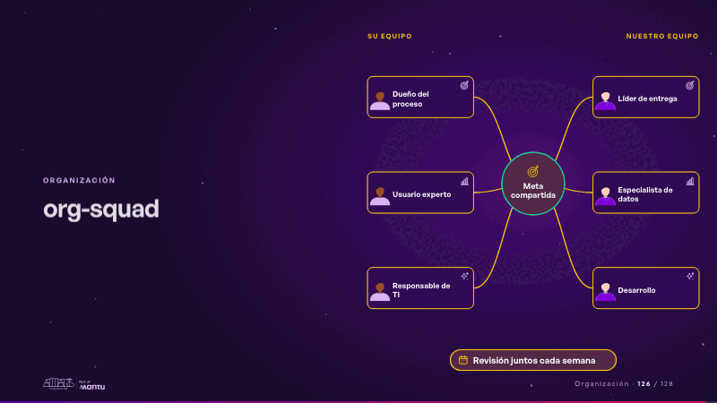
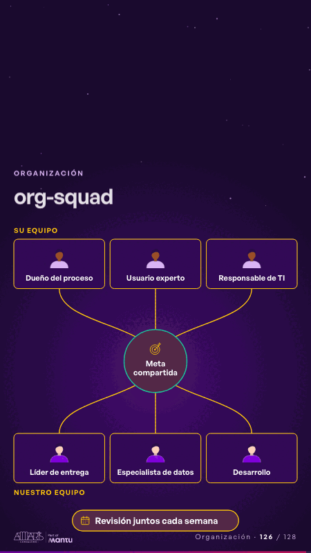

# org-squad · Organización

 

## Qué cuenta

Sus roles a un lado y los nuestros al otro, sin rostro, unidos por puentes punteados a una meta compartida al centro; abajo, el ritmo del trabajo.

## Cómo respira

Cada par conversa por turnos: un pulso va de su rol a la meta, sigue al nuestro y vuelve; el puente queda encendido. Con todos los puentes, la meta y el ritmo se encienden. Queda: un solo equipo.

## Cuándo usarla

Intención: **Organización** (org, who, process). Verticales: cualquiera. Layout `left`. Origen: dcd 0.6.0 · escena de catálogo. El snippet completo, listo para pegar en un storyboard: [`snippets/org-squad.json`](../../snippets/org-squad.json).

## Args

```json
{
 "layout": "left",
 "scene": "org-squad",
 "args": {
  "their_team": "‹como: Su equipo›",
  "our_team": "‹como: Nuestro equipo›",
  "their_roles": [
   "‹como: Dueño del proceso›",
   "‹como: Usuario experto›",
   "‹como: Responsable de TI›"
  ],
  "our_roles": [
   "‹como: Líder de entrega›",
   "‹como: Especialista de datos›",
   "‹como: Desarrollo›"
  ],
  "center": "‹como: Meta compartida›",
  "rhythm": "‹como: Revisión juntos cada semana›"
 }
}
```

## What it is

Organization scene, layout «left», for any decks. It lands at a glance, then breathes in a slow loop; its args (center, our_roles, our_team, rhythm, their_roles, their_team) carry every visible word, so the same scene serves a new client once the texts are rewritten.

## Relacionadas · Related

- [org-tree · Organización](org-tree.md)
- [automation-stairs · El mecanismo: cómo cambiaría su operación](automation-stairs.md)
- [before-after-lanes · Antes y después](before-after-lanes.md)
- [before-after-split · Antes y después](before-after-split.md)
- [build-deliver · Formación: la demo en vivo](build-deliver.md)
- [delivery-cycle · El mecanismo: cómo cambiaría su operación](delivery-cycle.md)

Fuente · source: [`scenes/story/intents_s09_16.py`](../../scenes/story/intents_s09_16.py) · sha256 `cf63c5919182`
