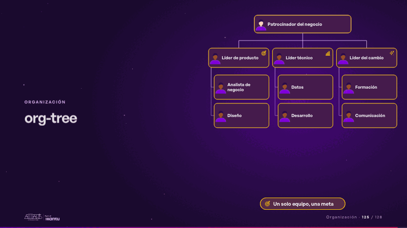
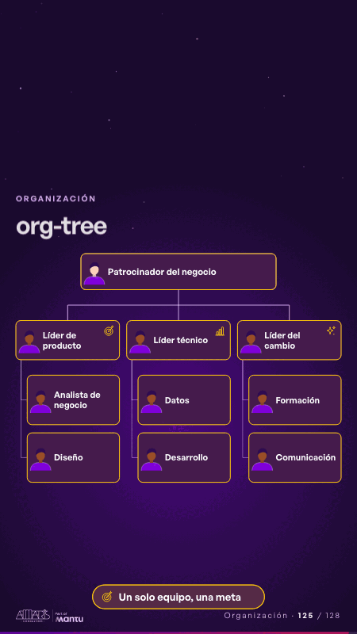

# org-tree · Organización

 

## Qué cuenta

Arriba, el patrocinador; debajo, tres líderes (cada uno con el ícono de un área de su negocio) y los roles de cada equipo, todos sin rostro; abajo, la meta.

## Cómo respira

Una chispa baja del patrocinador a cada líder y de ahí a sus roles, que se encienden uno a uno; al final se enciende la meta compartida. Queda: el equipo entero encendido.

## Cuándo usarla

Intención: **Organización** (org, who, governance). Verticales: cualquiera. Layout `left`. Origen: dcd 0.6.0 · escena de catálogo. El snippet completo, listo para pegar en un storyboard: [`snippets/org-tree.json`](../../snippets/org-tree.json).

## Args

```json
{
 "layout": "left",
 "scene": "org-tree",
 "args": {
  "top": "‹como: Patrocinador del negocio›",
  "teams": [
   {
    "lead": "‹como: Líder de producto›",
    "members": [
     "‹como: Analista de negocio›",
     "‹como: Diseño›"
    ]
   },
   {
    "lead": "‹como: Líder técnico›",
    "members": [
     "‹como: Datos›",
     "‹como: Desarrollo›"
    ]
   },
   {
    "lead": "‹como: Líder del cambio›",
    "members": [
     "‹como: Formación›",
     "‹como: Comunicación›"
    ]
   }
  ],
  "goal": "‹como: Un solo equipo, una meta›"
 }
}
```

## What it is

Organization scene, layout «left», for any decks. It lands at a glance, then breathes in a slow loop; its args (goal, teams, top) carry every visible word, so the same scene serves a new client once the texts are rewritten.

## Relacionadas · Related

- [org-squad · Organización](org-squad.md)
- [data-architecture · Diseño técnico por capas](data-architecture.md)
- [data-lifecycle · Lo que sus equipos comparten: el dato](data-lifecycle.md)
- [facts-columns · Lo que sus equipos comparten: el dato](facts-columns.md)
- [federated-live · Gobierno, permisos y control](federated-live.md)
- [infra-topology · Diseño técnico por capas](infra-topology.md)

Fuente · source: [`scenes/story/intents_s09_16.py`](../../scenes/story/intents_s09_16.py) · sha256 `cf63c5919182`
