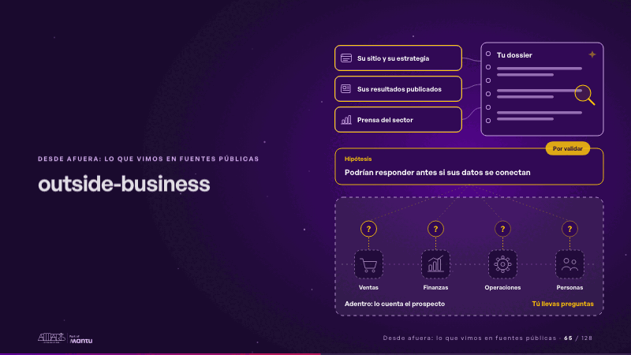
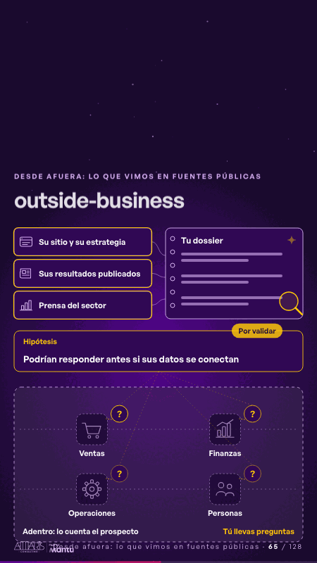

# outside-business · Desde afuera: lo que vimos en fuentes públicas

 

## Qué cuenta

Arriba, afuera, tres fuentes públicas del prospecto (su sitio y su estrategia, sus resultados publicados, la prensa del sector) y tu dossier; abajo, tras una línea punteada, su operación como una silueta que no vemos.

## Cómo respira

La lupa lee cada fuente y la deja en tu dossier; sale una hipótesis por validar y de ella bajan preguntas a cada estación: adentro lo cuenta el prospecto, tú llevas preguntas.

## Cuándo usarla

Intención: **Desde afuera: lo que vimos en fuentes públicas** (outside). Verticales: cualquiera. Layout `left`. Origen: Clase VR2 · diapositiva «Primero investigas al prospecto en lo que él publica». El snippet completo, listo para pegar en un storyboard: [`snippets/outside-business.json`](../../snippets/outside-business.json).

## Args

```json
{
 "layout": "left",
 "scene": "outside-business",
 "args": {
  "layers": [
   "‹como: Su sitio y su estrategia›",
   "‹como: Sus resultados publicados›",
   "‹como: Prensa del sector›"
  ],
  "book": "‹como: Tu dossier›",
  "case_label": "‹como: Hipótesis›",
  "case": "‹como: Podrían responder antes si sus datos se conectan›",
  "tag": "‹como: Por validar›",
  "inside": "‹como: Adentro: lo cuenta el prospecto›",
  "ask": "‹como: Tú llevas preguntas›",
  "areas": [
   "‹como: Ventas›",
   "‹como: Finanzas›",
   "‹como: Operaciones›",
   "‹como: Personas›"
  ]
 }
}
```

## What it is

Outside view from public sources scene, layout «left», for any decks. It lands at a glance, then breathes in a slow loop; its args (areas, ask, book, case, case_label, inside, layers, tag) carry every visible word, so the same scene serves a new client once the texts are rewritten.

## Relacionadas · Related

- [criterion · El criterio: retorno o habilitador](criterion.md)
- [discovery · Próximo paso: formas de empezar y discovery](discovery.md)
- [repeat-story · La brecha: su idea y lo que pasa cuando no se cumple](repeat-story.md)
- [hypotheses-live · Hipótesis por validar](hypotheses-live.md)
- [tickets-live · Cierre: su futuro, funcionando (el lema)](tickets-live.md)
- [hypotheses-quarter · Portada: su promesa](hypotheses-quarter.md)

Fuente · source: [`scenes/story/formacion_s05_afuera.py`](../../scenes/story/formacion_s05_afuera.py) · sha256 `ddf0fcfa3a64`
