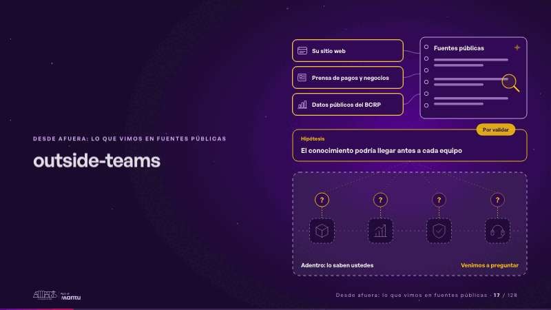
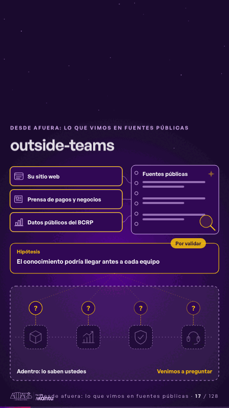

# outside-teams · Desde afuera: lo que vimos en fuentes públicas

 

## Qué cuenta

Arriba, afuera, tres fuentes públicas y nuestro cuaderno; abajo, tras una línea punteada, sus cuatro equipos dibujados como una silueta que no vemos.

## Cómo respira

La lupa lee cada fuente y la deja en el cuaderno; sale una hipótesis por validar y de ella baja una pregunta a cada equipo: lo de adentro lo cuentan ustedes.

## Cuándo usarla

Intención: **Desde afuera: lo que vimos en fuentes públicas** (outside). Verticales: cualquiera. Layout `left`. Origen: dcd · escena de catálogo (pagos). El snippet completo, listo para pegar en un storyboard: [`snippets/outside-teams.json`](../../snippets/outside-teams.json).

## Args

```json
{
 "layout": "left",
 "scene": "outside-teams",
 "args": {
  "layers": [
   "‹como: Su sitio web›",
   "‹como: Prensa de pagos y negocios›",
   "‹como: Datos públicos del BCRP›"
  ],
  "book": "‹como: Fuentes públicas›",
  "case_label": "‹como: Hipótesis›",
  "case": "‹como: El conocimiento podría llegar antes a cada equipo›",
  "tag": "‹como: Por validar›",
  "inside": "‹como: Adentro: lo saben ustedes›",
  "ask": "‹como: Venimos a preguntar›"
 }
}
```

## What it is

Outside view from public sources scene, layout «left», for any decks. It lands at a glance, then breathes in a slow loop; its args (ask, book, case, case_label, inside, layers, tag) carry every visible word, so the same scene serves a new client once the texts are rewritten.

## Relacionadas · Related

- [outside · Desde afuera: lo que vimos en fuentes públicas](outside.md)
- [outside-business · Desde afuera: lo que vimos en fuentes públicas](outside-business.md)
- [simple-outside · Desde afuera: lo que vimos en fuentes públicas](simple-outside.md)

Fuente · source: [`scenes/story/pagos_s01_03.py`](../../scenes/story/pagos_s01_03.py) · sha256 `826293d2c8e4`
