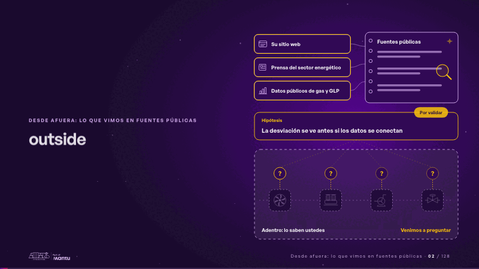
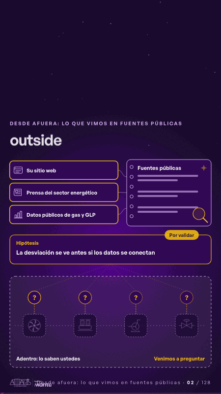

# outside · Desde afuera: lo que vimos en fuentes públicas

 

## Qué cuenta

Arriba, afuera, tres fuentes públicas y nuestro cuaderno; abajo, tras una línea punteada, su operación dibujada como una silueta que no vemos.

## Cómo respira

La lupa lee cada fuente y la deja en el cuaderno; sale una hipótesis por validar y de ella bajan preguntas a cada estación: lo de adentro lo cuentan ustedes.

## Cuándo usarla

Intención: **Desde afuera: lo que vimos en fuentes públicas** (outside). Verticales: energia. Layout `left`. Origen: dcd · escena de catálogo (energía). El snippet completo, listo para pegar en un storyboard: [`snippets/outside.json`](../../snippets/outside.json).

## Args

```json
{
 "layout": "left",
 "scene": "outside",
 "args": {
  "layers": [
   "‹como: Su sitio web›",
   "‹como: Prensa del sector energético›",
   "‹como: Datos públicos de gas y GLP›"
  ],
  "book": "‹como: Fuentes públicas›",
  "case_label": "‹como: Hipótesis›",
  "case": "‹como: La desviación se ve antes si los datos se conectan›",
  "tag": "‹como: Por validar›",
  "inside": "‹como: Adentro: lo saben ustedes›",
  "ask": "‹como: Venimos a preguntar›"
 }
}
```

## What it is

Outside view from public sources scene, layout «left», for energia decks. It lands at a glance, then breathes in a slow loop; its args (ask, book, case, case_label, inside, layers, tag) carry every visible word, so the same scene serves a new client once the texts are rewritten.

## Relacionadas · Related

- [cascade · La brecha: su idea y lo que pasa cuando no se cumple](cascade.md)
- [hero · Portada: su promesa](hero.md)
- [controlroom-live · Cierre: su futuro, funcionando (el lema)](controlroom-live.md)
- [hypotheses-live · Hipótesis por validar](hypotheses-live.md)
- [criterion · El criterio: retorno o habilitador](criterion.md)
- [discovery · Próximo paso: formas de empezar y discovery](discovery.md)

Fuente · source: [`scenes/story/energia_s01_03.py`](../../scenes/story/energia_s01_03.py) · sha256 `6ec42dd92e1d`
