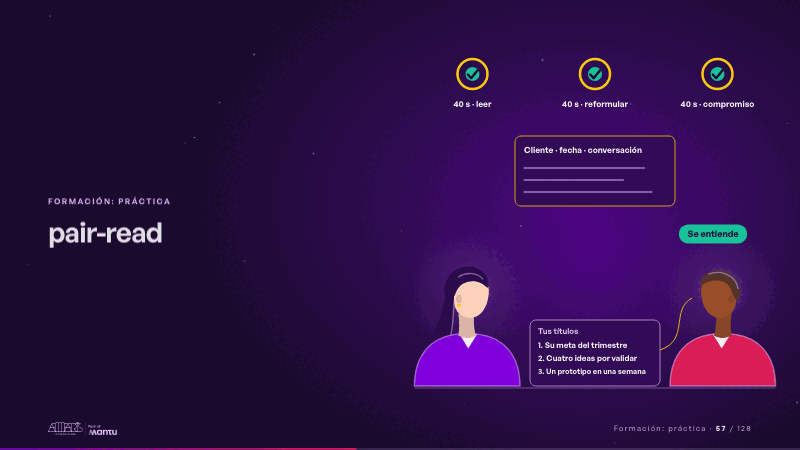
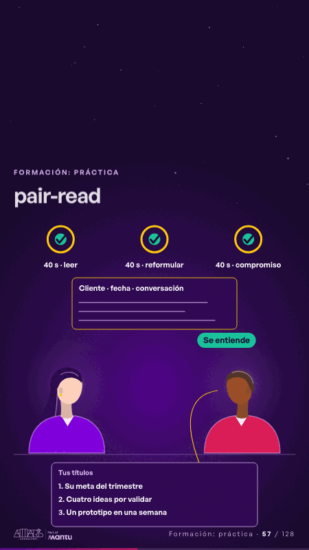

# pair-read · Formación: práctica

 

## Qué cuenta

Dos personas frente a frente con la lista de títulos entre ellas y, arriba, tres relojes de 40 segundos: leer, reformular y compromiso.

## Cómo respira

Una lee sus títulos y cada uno se enciende; la otra hace una sola pregunta, cuenta la historia de vuelta por un hilo que sale de la lista y aparece «Se entiende»; al final se escribe la nota «Cliente · fecha · conversación».

## Cuándo usarla

Intención: **Formación: práctica** (hands-on). Verticales: formacion. Layout `left`. Origen: Clase VR (formación) · diapositiva «Lee tus títulos a otra persona: ¿se entiende?». El snippet completo, listo para pegar en un storyboard: [`snippets/pair-read.json`](../../snippets/pair-read.json).

## Args

```json
{
 "layout": "left",
 "scene": "pair-read",
 "args": {
  "timers": [
   "‹como: 40 s · leer›",
   "‹como: 40 s · reformular›",
   "‹como: 40 s · compromiso›"
  ],
  "list_label": "‹como: Tus títulos›",
  "list": [
   "‹como: 1. Su meta del trimestre›",
   "‹como: 2. Cuatro ideas por validar›",
   "‹como: 3. Un prototipo en una semana›"
  ],
  "understood": "‹como: Se entiende›",
  "note": "‹como: Cliente · fecha · conversación›"
 }
}
```

## What it is

Training: hands-on scene, layout «left», for formacion decks. It lands at a glance, then breathes in a slow loop; its args (list, list_label, note, timers, understood) carry every visible word, so the same scene serves a new client once the texts are rewritten.

## Relacionadas · Related

- [hands-on-timer · Formación: práctica](hands-on-timer.md)
- [diagnostic · Formación: práctica](diagnostic.md)
- [build-deliver · Formación: la demo en vivo](build-deliver.md)
- [client-worries · La brecha: su idea y lo que pasa cuando no se cumple](client-worries.md)
- [facts-columns · Lo que sus equipos comparten: el dato](facts-columns.md)
- [generic-template · La brecha: su idea y lo que pasa cuando no se cumple](generic-template.md)

Fuente · source: [`scenes/story/formacion_s16_18.py`](../../scenes/story/formacion_s16_18.py) · sha256 `68e8f494ee34`
