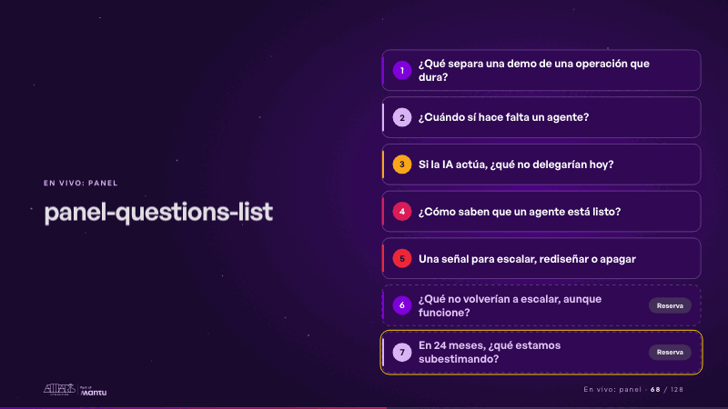
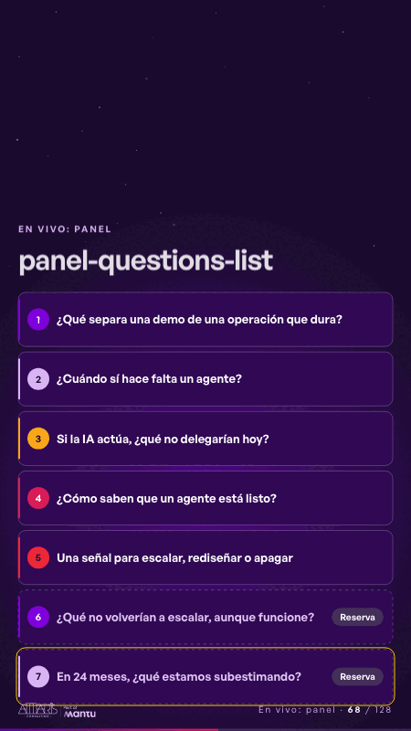

# panel-questions-list · En vivo: panel

 

## Qué cuenta

Las preguntas del panel, numeradas, en una columna; las dos de reserva, punteadas y con su etiqueta.

## Cómo respira

Un marco visita cada pregunta por turno hasta que el presentador toca la que está en curso: se enciende con «En curso» y las demás se atenúan; queda encendida hasta que toque otra. Cuadro final: todas legibles.

## Cuándo usarla

Intención: **En vivo: panel** (panel). Verticales: cualquiera. Layout `left`. Origen: any world · library scene (webinar-panel, 2026-10). El snippet completo, listo para pegar en un storyboard: [`snippets/panel-questions-list.json`](../../snippets/panel-questions-list.json).

## Args

```json
{
 "layout": "left",
 "scene": "panel-questions-list",
 "args": {
  "questions": [
   "‹como: ¿Qué separa una demo de una operación que dura?›",
   "‹como: ¿Cuándo sí hace falta un agente?›",
   "‹como: Si la IA actúa, ¿qué no delegarían hoy?›",
   "‹como: ¿Cómo saben que un agente está listo?›",
   "‹como: Una señal para escalar, rediseñar o apagar›",
   "‹como: ¿Qué no volverían a escalar, aunque funcione?›",
   "‹como: En 24 meses, ¿qué estamos subestimando?›"
  ],
  "reserve": 2,
  "reserve_label": "‹como: Reserva›",
  "live": "‹como: En curso›"
 }
}
```

## What it is

Live: panel scene, layout «left», for any decks. It lands at a glance, then breathes in a slow loop; its args (live, questions, reserve, reserve_label) carry every visible word, so the same scene serves a new client once the texts are rewritten.

## Relacionadas · Related

- [luz-panel · En vivo: panel](luz-panel.md)
- [panel-questions · En vivo: panel](panel-questions.md)

Fuente · source: [`scenes/story/webinar_panel.py`](../../scenes/story/webinar_panel.py) · sha256 `f1cb90ff6efe`
