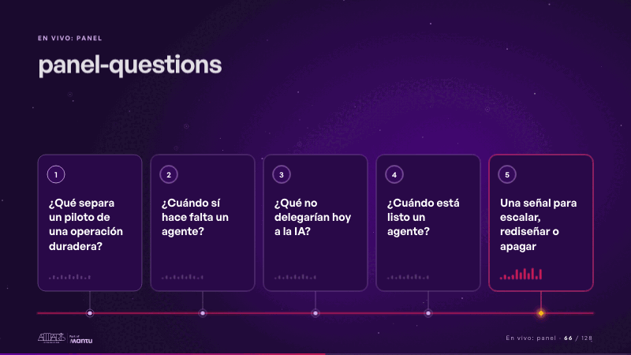
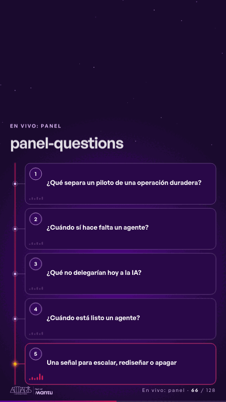

# panel-questions · En vivo: panel

 

## Qué cuenta

Cinco tarjetas altas de pregunta en fila, numeradas del 1 al 5, con las preguntas grandes y un medidor de voz quieto al pie, sobre una línea de luz magenta; al fondo, estrellas lejanas.

## Cómo respira

Sin toque, una chispa recorre la línea y se detiene bajo cada pregunta: una gota de luz sube por su tallo, el borde de su tarjeta se enciende suave y su medidor de voz habla; al tocar una (o pulsar su número), cae sobre ella la luz del escenario: haz dorado, halo, vidrio encendido, marco que late, la marca «En curso» y su medidor dorado que sigue hablando; las demás atenúan su vidrio sin perder la lectura y el recorrido se detiene. Cuadro final: las cinco preguntas visibles, sin ninguna marcada hasta el toque.

## Cuándo usarla

Intención: **En vivo: panel** (panel). Verticales: cualquiera. Layout `top`; mundo luz. Origen: webinar «IA: ¿el fin del piloto eterno?» · diapositiva «Cinco preguntas». El snippet completo, listo para pegar en un storyboard: [`snippets/panel-questions.json`](../../snippets/panel-questions.json).

## Args

```json
{
 "layout": "top",
 "scene": "panel-questions",
 "args": {
  "questions": [
   "‹como: ¿Qué separa un piloto de una operación duradera?›",
   "‹como: ¿Cuándo sí hace falta un agente?›",
   "‹como: ¿Qué no delegarían hoy a la IA?›",
   "‹como: ¿Cuándo está listo un agente?›",
   "‹como: Una señal para escalar, rediseñar o apagar›"
  ],
  "live": "‹como: En curso›"
 }
}
```

## What it is

Live: panel scene, layout «top», for any decks. It lands at a glance, then breathes in a slow loop; its args (live, questions) carry every visible word, so the same scene serves a new client once the texts are rewritten.

## Relacionadas · Related

- [discovery · Próximo paso: formas de empezar y discovery](discovery.md)
- [luz-bridge · KPI y casos de éxito](luz-bridge.md)
- [luz-divider · La brecha: su idea y lo que pasa cuando no se cumple](luz-divider.md)
- [luz-end · Cierre: su futuro, funcionando (el lema)](luz-end.md)
- [luz-figures · Una cifra pública (estática, con fuente)](luz-figures.md)
- [luz-hero · Portada: su promesa](luz-hero.md)

Fuente · source: [`scenes/story/webinar_s01_15.py`](../../scenes/story/webinar_s01_15.py) · sha256 `32ce7205f2f7`
