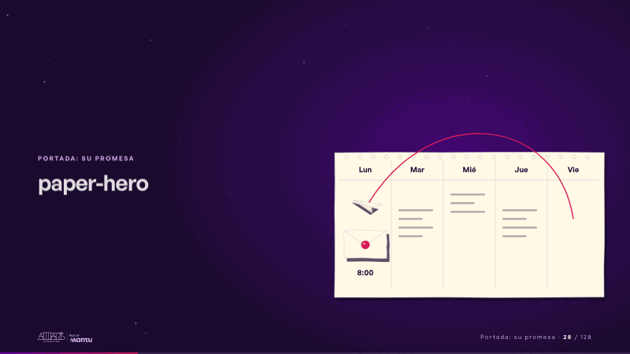
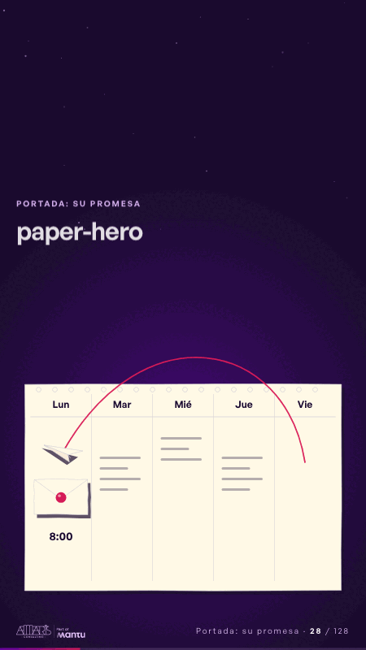

# paper-hero · Portada: su promesa

 

## Qué cuenta

El logo del cliente, el calendario de la semana y la hoja del informe sobre el viernes aparecen en menos de dos segundos.

## Cómo respira

La hoja del viernes se dobla en avión, cruza la semana dejando la cinta magenta y aterriza en el lunes, donde aparece un sobre sellado con su hora. Cuadro final: el sobre sellado sobre el lunes y el avión posado.

## Cuándo usarla

Intención: **Portada: su promesa** (hero). Verticales: cualquiera. Layout `left`; mundo papel. Origen: dcd · escena de catálogo (fidelización). El snippet completo, listo para pegar en un storyboard: [`snippets/paper-hero.json`](../../snippets/paper-hero.json).

## Args

```json
{
 "layout": "left",
 "scene": "paper-hero",
 "args": {
  "days": [
   "‹como: Lun›",
   "‹como: Mar›",
   "‹como: Mié›",
   "‹como: Jue›",
   "‹como: Vie›"
  ],
  "hour": "‹como: 8:00›"
 }
}
```

## What it is

Cover: their promise scene, layout «left», for any decks. It lands at a glance, then breathes in a slow loop; its args (days, hour) carry every visible word, so the same scene serves a new client once the texts are rewritten.

## Relacionadas · Related

- [pinned-request · La brecha: su idea y lo que pasa cuando no se cumple](pinned-request.md)
- [discovery · Próximo paso: formas de empezar y discovery](discovery.md)
- [lema-signer · Cierre: su futuro, funcionando (el lema)](lema-signer.md)
- [mondays-sent · La prueba y la evidencia](mondays-sent.md)
- [review-lens · Gobierno, permisos y control](review-lens.md)
- [strategy-map · El mecanismo: cómo cambiaría su operación](strategy-map.md)

Fuente · source: [`scenes/story/fidelizacion_s01_15.py`](../../scenes/story/fidelizacion_s01_15.py) · sha256 `c89653556c57`
