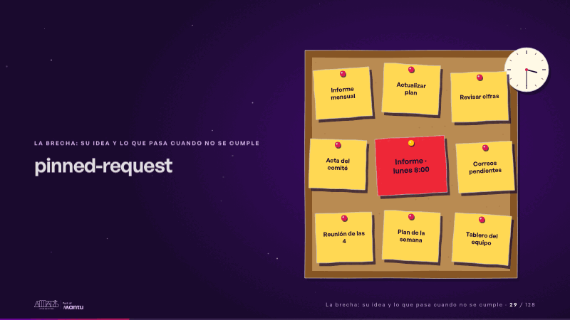
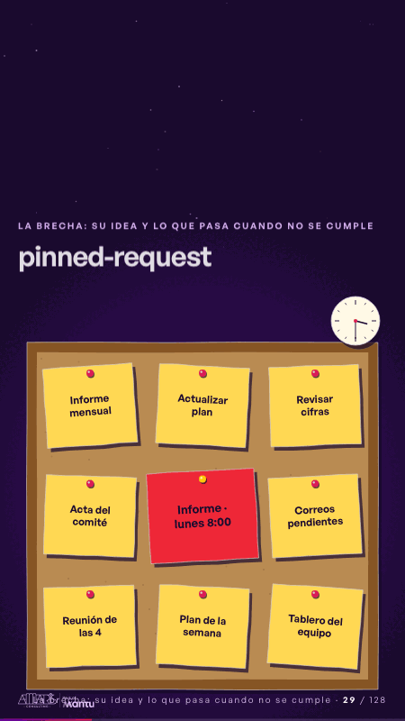

# pinned-request · La brecha: su idea y lo que pasa cuando no se cumple

 

## Qué cuenta

El corcho con sus primeros post-its y un reloj de papel que marca 3:30.

## Cómo respira

Caen post-its hasta llenar el corcho; al final entra uno rojo, «Informe · lunes 8:00», y la chincheta lo clava al centro. Cuadro final: tablero lleno, post-it rojo clavado.

## Cuándo usarla

Intención: **La brecha: su idea y lo que pasa cuando no se cumple** (gap). Verticales: cualquiera. Layout `left`; mundo papel. Origen: dcd · escena de catálogo (fidelización). El snippet completo, listo para pegar en un storyboard: [`snippets/pinned-request.json`](../../snippets/pinned-request.json).

## Args

```json
{
 "layout": "left",
 "scene": "pinned-request",
 "args": {
  "postits": [
   "‹como: Informe mensual›",
   "‹como: Actualizar plan›",
   "‹como: Revisar cifras›",
   "‹como: Acta del comité›",
   "‹como: Correos pendientes›",
   "‹como: Reunión de las 4›",
   "‹como: Plan de la semana›",
   "‹como: Tablero del equipo›"
  ],
  "urgent": "‹como: Informe · lunes 8:00›"
 }
}
```

## What it is

The gap scene, layout «left», for any decks. It lands at a glance, then breathes in a slow loop; its args (postits, urgent) carry every visible word, so the same scene serves a new client once the texts are rewritten.

## Relacionadas · Related

- [paper-hero · Portada: su promesa](paper-hero.md)
- [strategy-map · El mecanismo: cómo cambiaría su operación](strategy-map.md)
- [discovery · Próximo paso: formas de empezar y discovery](discovery.md)
- [lema-signer · Cierre: su futuro, funcionando (el lema)](lema-signer.md)
- [mondays-sent · La prueba y la evidencia](mondays-sent.md)
- [review-lens · Gobierno, permisos y control](review-lens.md)

Fuente · source: [`scenes/story/fidelizacion_s01_15.py`](../../scenes/story/fidelizacion_s01_15.py) · sha256 `c89653556c57`
