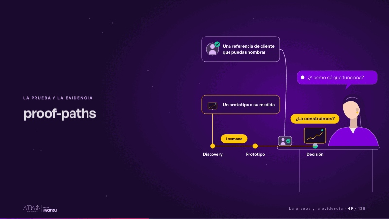
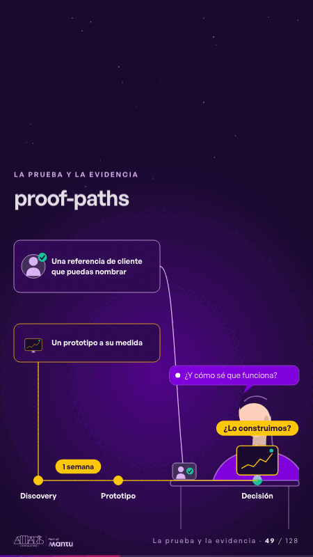

# proof-paths · La prueba y la evidencia

 

## Qué cuenta

El cliente, detrás de su mesa, pregunta «¿Y cómo sé que funciona?»; a la izquierda, dos caminos punteados llegan a su mesa: una referencia de cliente que puedas nombrar y un prototipo a su medida.

## Cómo respira

La referencia recorre su camino y deja su ficha en la mesa; luego la línea de tiempo avanza de Discovery a Prototipo en una semana, el prototipo viaja a la mesa y aterriza con «¿Lo construimos?». Cuadro final: los dos caminos trazados y el prototipo sobre la mesa.

## Cuándo usarla

Intención: **La prueba y la evidencia** (proof, cta). Verticales: formacion, cualquiera. Layout `left`. Origen: Clase VR (formación) · diapositiva «Demuestras con una referencia de cliente o un prototipo». El snippet completo, listo para pegar en un storyboard: [`snippets/proof-paths.json`](../../snippets/proof-paths.json).

## Args

```json
{
 "layout": "left",
 "scene": "proof-paths",
 "args": {
  "ask": "‹como: ¿Y cómo sé que funciona?›",
  "paths": [
   "‹como: Una referencia de cliente que puedas nombrar›",
   "‹como: Un prototipo a su medida›"
  ],
  "steps": [
   "‹como: Discovery›",
   "‹como: Prototipo›",
   "‹como: Decisión›"
  ],
  "span": "‹como: 1 semana›",
  "decide": "‹como: ¿Lo construimos?›"
 }
}
```

## What it is

Proof and evidence scene, layout «left», for formacion, any decks. It lands at a glance, then breathes in a slow loop; its args (ask, decide, paths, span, steps) carry every visible word, so the same scene serves a new client once the texts are rewritten.

## Relacionadas · Related

- [kpi-card · KPI y casos de éxito](kpi-card.md)
- [criterion · El criterio: retorno o habilitador](criterion.md)
- [hypotheses-live · Hipótesis por validar](hypotheses-live.md)
- [discovery · Próximo paso: formas de empezar y discovery](discovery.md)
- [capacity-join · La prueba y la evidencia](capacity-join.md)
- [lema-conversation · Cierre: su futuro, funcionando (el lema)](lema-conversation.md)

Fuente · source: [`scenes/story/formacion_s10_12.py`](../../scenes/story/formacion_s10_12.py) · sha256 `e51f23629e2f`
