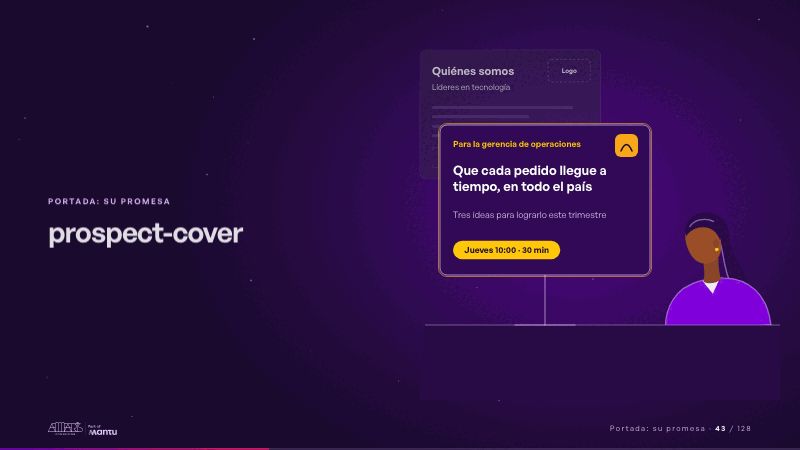
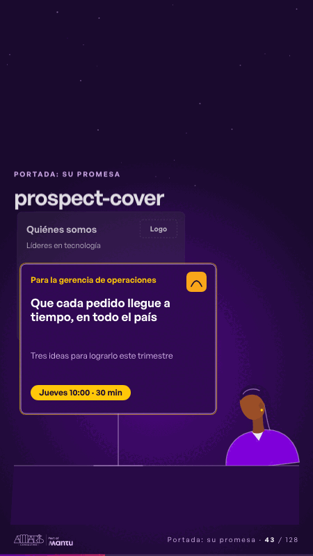

# prospect-cover · Portada: su promesa

 

## Qué cuenta

Sobre la mesa, una plantilla gris: «Quiénes somos», «Líderes en tecnología» y un hueco para el logo; al otro lado, una gerente sin rostro.

## Cómo respira

La plantilla se aparta y se apaga; delante se arma una portada para un solo prospecto: para quién es, su promesa, su logo y la reunión del jueves. La gerente se inclina hacia ella. Cuadro final: la portada a la medida encendida, la plantilla tenue detrás.

## Cuándo usarla

Intención: **Portada: su promesa** (hero). Verticales: formacion. Layout `left`. Origen: Clase VR (formación) · diapositiva «Tu prospecto sabe en un minuto si es para él». El snippet completo, listo para pegar en un storyboard: [`snippets/prospect-cover.json`](../../snippets/prospect-cover.json).

## Args

```json
{
 "layout": "left",
 "scene": "prospect-cover",
 "args": {
  "tpl_title": "‹como: Quiénes somos›",
  "tpl_line": "‹como: Líderes en tecnología›",
  "tpl_logo": "‹como: Logo›",
  "for_whom": "‹como: Para la gerencia de operaciones›",
  "promise": "‹como: Que cada pedido llegue a tiempo, en todo el país›",
  "cover_sub": "‹como: Tres ideas para lograrlo este trimestre›",
  "meeting": "‹como: Jueves 10:00 · 30 min›"
 }
}
```

## What it is

Cover: their promise scene, layout «left», for formacion decks. It lands at a glance, then breathes in a slow loop; its args (cover_sub, for_whom, meeting, promise, tpl_line, tpl_logo, tpl_title) carry every visible word, so the same scene serves a new client once the texts are rewritten.

## Relacionadas · Related

- [week-calendar · La brecha: su idea y lo que pasa cuando no se cumple](week-calendar.md)
- [lema-conversation · Cierre: su futuro, funcionando (el lema)](lema-conversation.md)
- [discovery · Próximo paso: formas de empezar y discovery](discovery.md)
- [hypotheses-live · Hipótesis por validar](hypotheses-live.md)
- [criterion · El criterio: retorno o habilitador](criterion.md)
- [outside-business · Desde afuera: lo que vimos en fuentes públicas](outside-business.md)

Fuente · source: [`scenes/story/formacion_s01_03.py`](../../scenes/story/formacion_s01_03.py) · sha256 `68ee479403f2`
