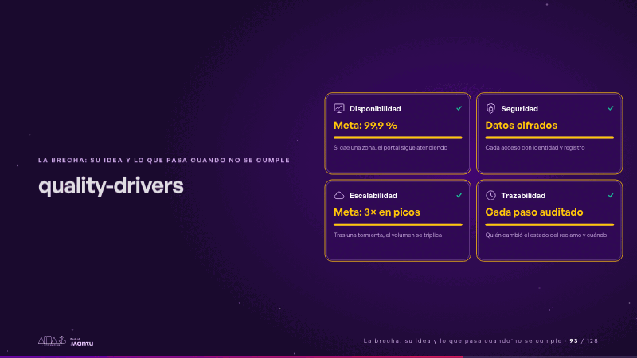
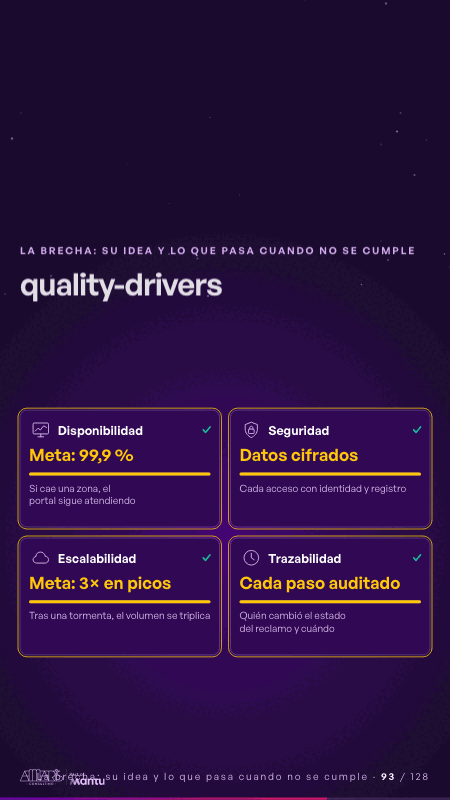

# quality-drivers · La brecha: su idea y lo que pasa cuando no se cumple

 

## Qué cuenta

Cuatro tarjetas: disponibilidad, seguridad, escalabilidad y trazabilidad, cada una con su meta.

## Cómo respira

Cada atributo se enciende por turno, su barra llega a la meta y recibe su visto bueno.

## Cuándo usarla

Intención: **La brecha: su idea y lo que pasa cuando no se cumple** (gap, architecture). Verticales: cualquiera. Layout `left`. Origen: Arquitectura demo (Aseguradora Andina, ficticia) · diapositiva «Cuatro atributos de calidad guían cada decisión técnica». El snippet completo, listo para pegar en un storyboard: [`snippets/quality-drivers.json`](../../snippets/quality-drivers.json).

## Args

```json
{
 "layout": "left",
 "scene": "quality-drivers",
 "args": {
  "drivers": [
   [
    "‹como: Disponibilidad›",
    "‹como: Meta: 99,9 %›",
    "‹como: Si cae una zona, el portal sigue atendiendo›"
   ],
   [
    "‹como: Seguridad›",
    "‹como: Datos cifrados›",
    "‹como: Cada acceso con identidad y registro›"
   ],
   [
    "‹como: Escalabilidad›",
    "‹como: Meta: 3× en picos›",
    "‹como: Tras una tormenta, el volumen se triplica›"
   ],
   [
    "‹como: Trazabilidad›",
    "‹como: Cada paso auditado›",
    "‹como: Quién cambió el estado del reclamo y cuándo›"
   ]
  ]
 }
}
```

## What it is

The gap scene, layout «left», for any decks. It lands at a glance, then breathes in a slow loop; its args (drivers) carry every visible word, so the same scene serves a new client once the texts are rewritten.

## Relacionadas · Related

- [risks-tradeoffs · Diseño técnico por capas](risks-tradeoffs.md)
- [adr-decisions · Diseño técnico por capas](adr-decisions.md)
- [arq-hero · Portada: su promesa](arq-hero.md)
- [automation-stairs · El mecanismo: cómo cambiaría su operación](automation-stairs.md)
- [before-after-split · Antes y después](before-after-split.md)
- [c4-code · Diseño técnico por capas](c4-code.md)

Fuente · source: [`scenes/story/arquitectura.py`](../../scenes/story/arquitectura.py) · sha256 `01c6a4b3e10f`
