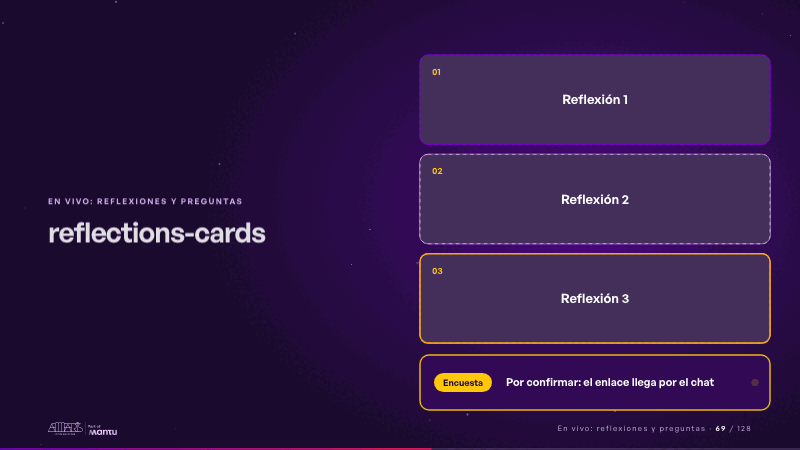
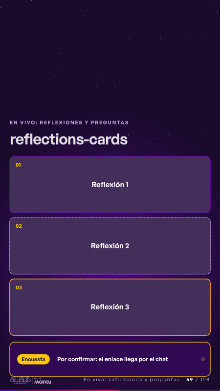

# reflections-cards · En vivo: reflexiones y preguntas

 

## Qué cuenta

Tres tarjetas boca abajo, «Reflexión 1», «Reflexión 2» y «Reflexión 3», y debajo la encuesta.

## Cómo respira

Los bordes de las tarjetas se encienden por turno; el moderador toca cada una al decirla y se voltea con su texto y una línea que sigue escribiendo. Cuadro final: las tres caras y la encuesta.

## Cuándo usarla

Intención: **En vivo: reflexiones y preguntas** (reflection). Verticales: cualquiera. Layout `left`. Origen: any world · library scene (webinar-panel, 2026-10). El snippet completo, listo para pegar en un storyboard: [`snippets/reflections-cards.json`](../../snippets/reflections-cards.json).

## Args

```json
{
 "layout": "left",
 "scene": "reflections-cards",
 "args": {
  "label": "‹como: Reflexión›",
  "cards": [
   "‹como: Se anota en vivo›",
   "‹como: Se anota en vivo›",
   "‹como: Se anota en vivo›"
  ],
  "survey": [
   "‹como: Encuesta›",
   "‹como: Por confirmar: el enlace llega por el chat›"
  ]
 }
}
```

## What it is

Live: reflections and questions scene, layout «left», for any decks. It lands at a glance, then breathes in a slow loop; its args (cards, label, survey) carry every visible word, so the same scene serves a new client once the texts are rewritten.

## Relacionadas · Related

- [chain-tap · Diseño técnico por capas](chain-tap.md)
- [luz-question · En vivo: reflexiones y preguntas](luz-question.md)
- [reflections-live · En vivo: reflexiones y preguntas](reflections-live.md)
- [time-back · En vivo: reflexiones y preguntas](time-back.md)
- [time-freed · En vivo: reflexiones y preguntas](time-freed.md)
- [unfold-describe · En vivo: reflexiones y preguntas](unfold-describe.md)

Fuente · source: [`scenes/story/webinar_panel.py`](../../scenes/story/webinar_panel.py) · sha256 `f1cb90ff6efe`
