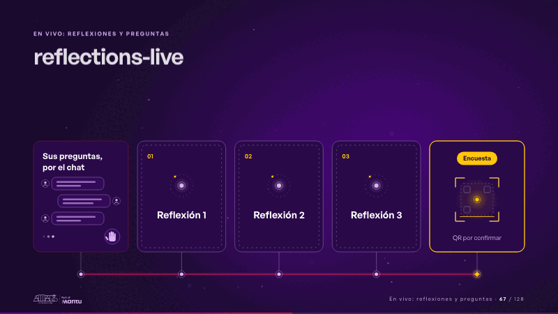
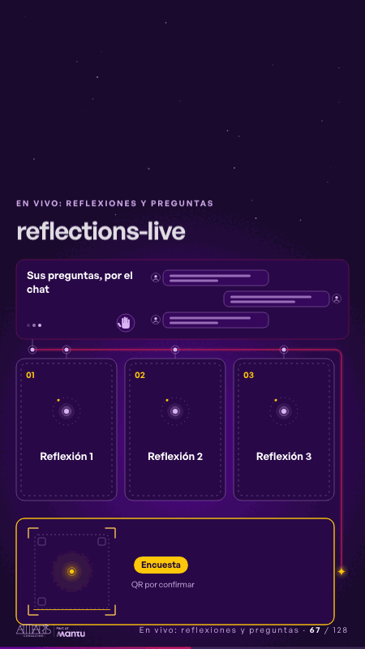

# reflections-live · En vivo: reflexiones y preguntas

 

## Qué cuenta

Cinco momentos sobre un mismo hilo de luz, en el orden del cierre: a la izquierda el chat «Sus preguntas, por el chat»; al centro, tres tarjetas de vidrio oscuro boca abajo, «Reflexión 1», «Reflexión 2» y «Reflexión 3»; a la derecha, la encuesta con su marco de QR.

## Cómo respira

Sin toque, primero late el chat: se levanta una mano con sus ondas, llegan tres mensajes uno a uno y alguien sigue escribiendo; luego una chispa sale del chat por el hilo y se detiene bajo cada reflexión, cuyo borde se enciende por turnos, y al final bajo la encuesta, que se enciende dorada y barre su marco de QR; al tocar una tarjeta (o pulsar 1, 2 o 3), el moderador la voltea y muestra «Se anota en vivo» bajo su número, con tres líneas de nota que se escriben solas, y queda volteada. Cuadro final: los mensajes en el chat, las tres tarjetas boca abajo y la encuesta encendida.

## Cuándo usarla

Intención: **En vivo: reflexiones y preguntas** (reflection, cta). Verticales: cualquiera. Layout `top`; mundo luz. Origen: webinar «IA: ¿el fin del piloto eterno?» · diapositiva «Tres reflexiones de hoy». El snippet completo, listo para pegar en un storyboard: [`snippets/reflections-live.json`](../../snippets/reflections-live.json).

## Args

```json
{
 "layout": "top",
 "scene": "reflections-live",
 "args": {
  "reflections": [
   "‹como: Reflexión 1›",
   "‹como: Reflexión 2›",
   "‹como: Reflexión 3›"
  ],
  "live": "‹como: Se anota en vivo›",
  "survey": [
   "‹como: Encuesta›",
   "‹como: QR por confirmar›"
  ],
  "ask": "‹como: Sus preguntas, por el chat›"
 }
}
```

## What it is

Live: reflections and questions scene, layout «top», for any decks. It lands at a glance, then breathes in a slow loop; its args (ask, live, reflections, survey) carry every visible word, so the same scene serves a new client once the texts are rewritten.

## Relacionadas · Related

- [luz-bridge · KPI y casos de éxito](luz-bridge.md)
- [discovery · Próximo paso: formas de empezar y discovery](discovery.md)
- [hypotheses-live · Hipótesis por validar](hypotheses-live.md)
- [luz-divider · La brecha: su idea y lo que pasa cuando no se cumple](luz-divider.md)
- [luz-end · Cierre: su futuro, funcionando (el lema)](luz-end.md)
- [luz-figures · Una cifra pública (estática, con fuente)](luz-figures.md)

Fuente · source: [`scenes/story/webinar_s01_15.py`](../../scenes/story/webinar_s01_15.py) · sha256 `32ce7205f2f7`
