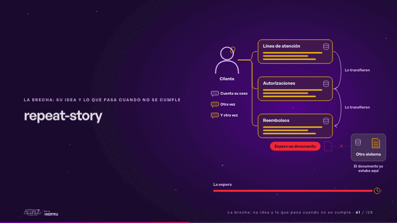
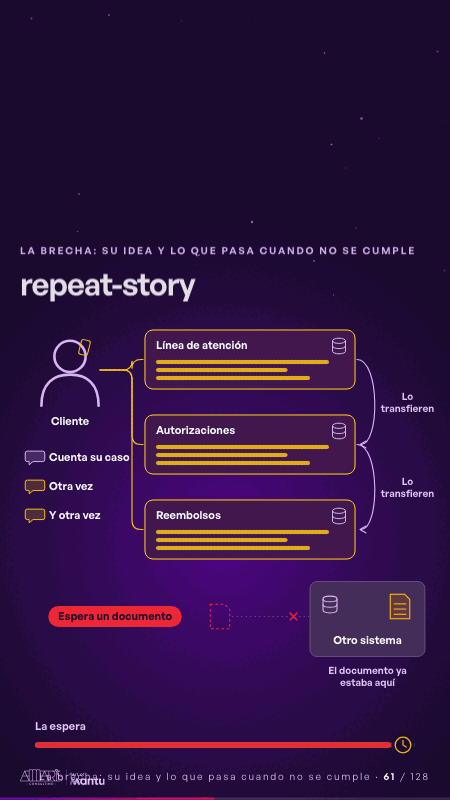

# repeat-story · La brecha: su idea y lo que pasa cuando no se cumple

 

## Qué cuenta

El cliente a la izquierda y, a su lado, tres canales vacíos, cada uno con su propio sistema; abajo, otro sistema aparte y la barra de la espera.

## Cómo respira

El cliente cuenta su caso a la línea de atención; lo transfieren, el siguiente canal pregunta «¿Me cuenta su caso?» y lo cuenta otra vez, y otra; el reembolso espera un documento que ya estaba en otro sistema, el intento no cruza, y la espera crece hasta volverse roja.

## Cuándo usarla

Intención: **La brecha: su idea y lo que pasa cuando no se cumple** (gap). Verticales: salud, cualquiera. Layout `left`. Origen: dcd · escena de catálogo (salud). El snippet completo, listo para pegar en un storyboard: [`snippets/repeat-story.json`](../../snippets/repeat-story.json).

## Args

```json
{
 "layout": "left",
 "scene": "repeat-story",
 "args": {
  "client": "‹como: Cliente›",
  "tells": [
   "‹como: Cuenta su caso›",
   "‹como: Otra vez›",
   "‹como: Y otra vez›"
  ],
  "channels": [
   "‹como: Línea de atención›",
   "‹como: Autorizaciones›",
   "‹como: Reembolsos›"
  ],
  "ask": "‹como: ¿Me cuenta su caso?›",
  "transfer": "‹como: Lo transfieren›",
  "status": "‹como: Espera un documento›",
  "other": "‹como: Otro sistema›",
  "there": "‹como: El documento ya estaba aquí›",
  "wait": "‹como: La espera›"
 }
}
```

## What it is

The gap scene, layout «left», for salud, any decks. It lands at a glance, then breathes in a slow loop; its args (ask, channels, client, other, status, tells, there, transfer, wait) carry every visible word, so the same scene serves a new client once the texts are rewritten.

## Relacionadas · Related

- [discovery · Próximo paso: formas de empezar y discovery](discovery.md)
- [criterion · El criterio: retorno o habilitador](criterion.md)
- [tickets-live · Cierre: su futuro, funcionando (el lema)](tickets-live.md)
- [hypotheses-live · Hipótesis por validar](hypotheses-live.md)
- [hypotheses-quarter · Portada: su promesa](hypotheses-quarter.md)
- [outside-business · Desde afuera: lo que vimos en fuentes públicas](outside-business.md)

Fuente · source: [`scenes/story/salud_s04_06.py`](../../scenes/story/salud_s04_06.py) · sha256 `949d43c2c872`
