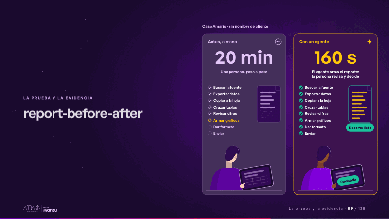
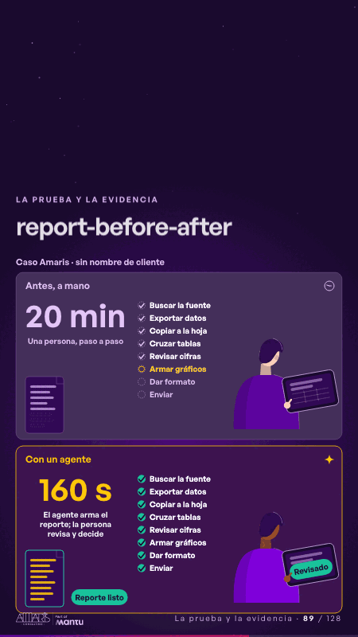

# report-before-after · La prueba y la evidencia

 

## Qué cuenta

Dos paneles lado a lado con sus cifras fijas: «20 min», atenuado, y «160 s», encendido; en cada uno, los mismos pasos del reporte, la hoja que llenan y, abajo, de espaldas, una persona con su tablet. Arriba, «Caso Amaris · sin nombre de cliente».

## Cómo respira

Un bucle de 12 segundos que muestra el proceso, no las cifras: a la izquierda la persona avanza a mano, un paso cada casi dos segundos; a la derecha el agente marca los mismos pasos en un instante, el reporte queda listo, baja a la tablet y la persona toca «Revisado». Cuadro final: a la derecha el reporte listo y revisado; a la izquierda el camino manual sigue en el sexto paso.

## Cuándo usarla

Intención: **La prueba y la evidencia** (proof, kpi). Verticales: cualquiera. Layout `left`. Origen: dcd · escena de catálogo (banca). El snippet completo, listo para pegar en un storyboard: [`snippets/report-before-after.json`](../../snippets/report-before-after.json).

## Args

```json
{
 "layout": "left",
 "scene": "report-before-after",
 "args": {
  "tag": "‹como: Caso Amaris · sin nombre de cliente›",
  "sides": [
   [
    "‹como: Antes, a mano›",
    "‹como: 20 min›",
    "‹como: Una persona, paso a paso›"
   ],
   [
    "‹como: Con un agente›",
    "‹como: 160 s›",
    "‹como: El agente arma el reporte; la persona revisa y decide›"
   ]
  ],
  "tasks": [
   "‹como: Buscar la fuente›",
   "‹como: Exportar datos›",
   "‹como: Copiar a la hoja›",
   "‹como: Cruzar tablas›",
   "‹como: Revisar cifras›",
   "‹como: Armar gráficos›",
   "‹como: Dar formato›",
   "‹como: Enviar›"
  ],
  "ready": "‹como: Reporte listo›",
  "review": [
   "‹como: Revisar›",
   "‹como: Revisado›"
  ]
 }
}
```

## What it is

Proof and evidence scene, layout «left», for any decks. It lands at a glance, then breathes in a slow loop; its args (ready, review, sides, tag, tasks) carry every visible word, so the same scene serves a new client once the texts are rewritten.

## Relacionadas · Related

- [kpi-card · KPI y casos de éxito](kpi-card.md)
- [mondays-sent · La prueba y la evidencia](mondays-sent.md)
- [simple-proof · La prueba y la evidencia](simple-proof.md)
- [success-case · La prueba y la evidencia](success-case.md)
- [capacity-join · La prueba y la evidencia](capacity-join.md)
- [client-worries · La brecha: su idea y lo que pasa cuando no se cumple](client-worries.md)

Fuente · source: [`scenes/story/banca_d01_06.py`](../../scenes/story/banca_d01_06.py) · sha256 `9deb39acebfb`
