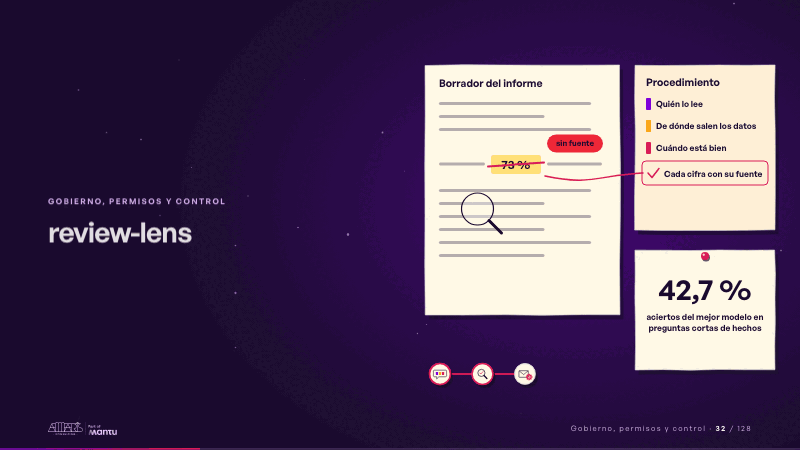
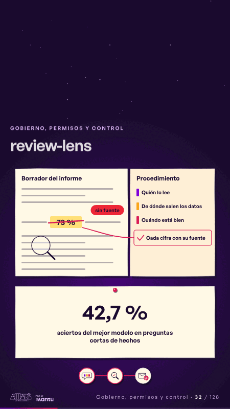

# review-lens · Gobierno, permisos y control

 

## Qué cuenta

El borrador de papel con sus líneas y una cifra resaltada; al lado, el procedimiento con sus tres pasos y, debajo, la cifra de 42,7 % fija en su marco; en la esquina, el mapa con la primera parada encendida.

## Cómo respira

La lupa recorre el borrador y se detiene en la cifra sin fuente; un trazo magenta la tacha y la cinta la lleva al procedimiento, que gana una línea nueva, «cada cifra con su fuente»; se enciende la segunda parada. Cuadro final: cifra tachada, paso agregado, 42,7 % quieto.

## Cuándo usarla

Intención: **Gobierno, permisos y control** (governance, figure). Verticales: cualquiera. Layout `left`; mundo papel. Origen: dcd · escena de catálogo (fidelización). El snippet completo, listo para pegar en un storyboard: [`snippets/review-lens.json`](../../snippets/review-lens.json).

## Args

```json
{
 "layout": "left",
 "scene": "review-lens",
 "args": {
  "draft": "‹como: Borrador del informe›",
  "invented": "‹como: 73 %›",
  "nosource": "‹como: sin fuente›",
  "proc": "‹como: Procedimiento›",
  "steps": [
   "‹como: Quién lo lee›",
   "‹como: De dónde salen los datos›",
   "‹como: Cuándo está bien›"
  ],
  "step": "‹como: Cada cifra con su fuente›",
  "figure": "‹como: 42,7 %›",
  "label": "‹como: aciertos del mejor modelo en preguntas cortas de hechos›"
 }
}
```

## What it is

Governance, permissions and control scene, layout «left», for any decks. It lands at a glance, then breathes in a slow loop; its args (draft, figure, invented, label, nosource, proc, step, steps) carry every visible word, so the same scene serves a new client once the texts are rewritten.

## Relacionadas · Related

- [discovery · Próximo paso: formas de empezar y discovery](discovery.md)
- [mondays-sent · La prueba y la evidencia](mondays-sent.md)
- [lema-signer · Cierre: su futuro, funcionando (el lema)](lema-signer.md)
- [paper-hero · Portada: su promesa](paper-hero.md)
- [pinned-request · La brecha: su idea y lo que pasa cuando no se cumple](pinned-request.md)
- [strategy-map · El mecanismo: cómo cambiaría su operación](strategy-map.md)

Fuente · source: [`scenes/story/fidelizacion_s01_15.py`](../../scenes/story/fidelizacion_s01_15.py) · sha256 `c89653556c57`
