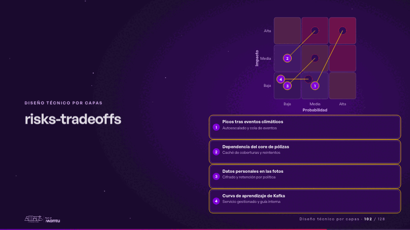
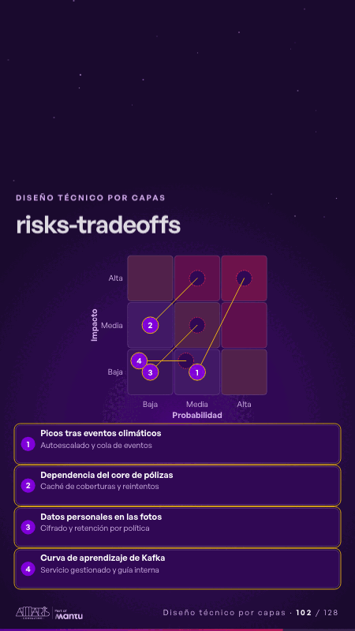

# risks-tradeoffs · Diseño técnico por capas

 

## Qué cuenta

Una matriz de probabilidad por impacto con cuatro riesgos numerados y, debajo, la lista con su mitigación.

## Cómo respira

Cada riesgo late en su celda, su fila se enciende con la mitigación y el riesgo se mueve a su celda residual.

## Cuándo usarla

Intención: **Diseño técnico por capas** (architecture, gap). Verticales: cualquiera. Layout `left`. Origen: Arquitectura demo (Aseguradora Andina, ficticia) · diapositiva «Cada riesgo tiene su mitigación y su costo». El snippet completo, listo para pegar en un storyboard: [`snippets/risks-tradeoffs.json`](../../snippets/risks-tradeoffs.json).

## Args

```json
{
 "layout": "left",
 "scene": "risks-tradeoffs",
 "args": {
  "risks": [
   [
    "‹como: Picos tras eventos climáticos›",
    3,
    3,
    "‹como: Autoescalado y cola de eventos›",
    [
     2,
     1
    ]
   ],
   [
    "‹como: Dependencia del core de pólizas›",
    2,
    3,
    "‹como: Caché de coberturas y reintentos›",
    [
     1,
     2
    ]
   ],
   [
    "‹como: Datos personales en las fotos›",
    2,
    2,
    "‹como: Cifrado y retención por política›",
    [
     1,
     1
    ]
   ],
   [
    "‹como: Curva de aprendizaje de Kafka›",
    2,
    1,
    "‹como: Servicio gestionado y guía interna›",
    [
     1,
     1
    ]
   ]
  ]
 }
}
```

## What it is

Layered technical design scene, layout «left», for any decks. It lands at a glance, then breathes in a slow loop; its args (risks) carry every visible word, so the same scene serves a new client once the texts are rewritten.

## Relacionadas · Related

- [quality-drivers · La brecha: su idea y lo que pasa cuando no se cumple](quality-drivers.md)
- [adr-decisions · Diseño técnico por capas](adr-decisions.md)
- [arq-hero · Portada: su promesa](arq-hero.md)
- [automation-stairs · El mecanismo: cómo cambiaría su operación](automation-stairs.md)
- [before-after-split · Antes y después](before-after-split.md)
- [c4-code · Diseño técnico por capas](c4-code.md)

Fuente · source: [`scenes/story/arquitectura.py`](../../scenes/story/arquitectura.py) · sha256 `01c6a4b3e10f`
