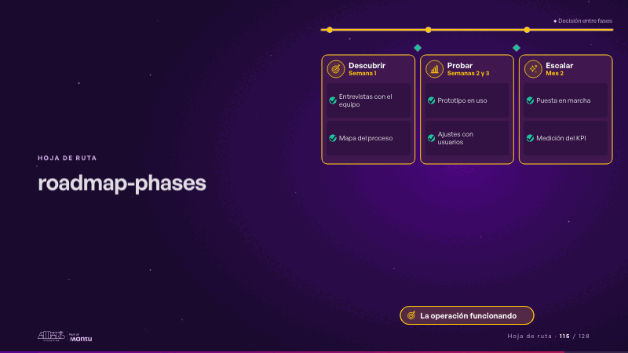
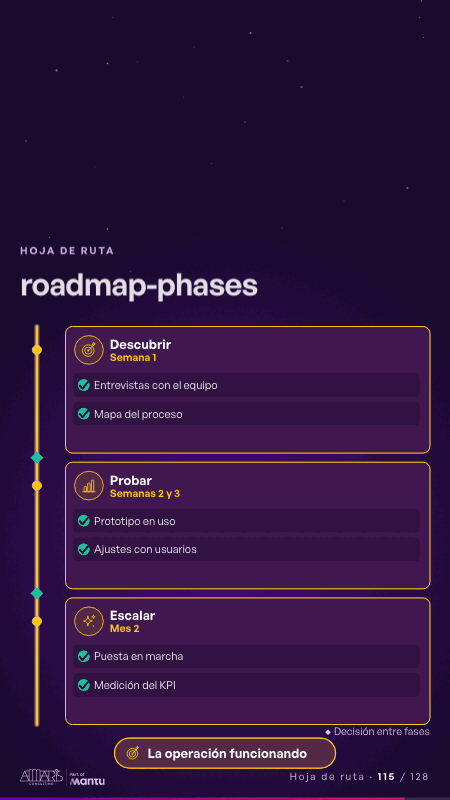

# roadmap-phases · Hoja de ruta

 

## Qué cuenta

Una línea de tiempo con tres fases (su nombre, su periodo y dos entregables cada una) y un rombo de decisión entre fase y fase; abajo, la meta.

## Cómo respira

La barra de avance recorre la línea: cada fase se enciende, sus entregables reciben su visto y el rombo de decisión se abre hacia la siguiente; al final se enciende la meta. Queda: las tres fases hechas y la meta encendida.

## Cuándo usarla

Intención: **Hoja de ruta** (roadmap, cta, process). Verticales: cualquiera. Layout `left`. Origen: dcd 0.6.0 · escena de catálogo. El snippet completo, listo para pegar en un storyboard: [`snippets/roadmap-phases.json`](../../snippets/roadmap-phases.json).

## Args

```json
{
 "layout": "left",
 "scene": "roadmap-phases",
 "args": {
  "phases": [
   {
    "name": "‹como: Descubrir›",
    "when": "‹como: Semana 1›",
    "items": [
     "‹como: Entrevistas con el equipo›",
     "‹como: Mapa del proceso›"
    ]
   },
   {
    "name": "‹como: Probar›",
    "when": "‹como: Semanas 2 y 3›",
    "items": [
     "‹como: Prototipo en uso›",
     "‹como: Ajustes con usuarios›"
    ]
   },
   {
    "name": "‹como: Escalar›",
    "when": "‹como: Mes 2›",
    "items": [
     "‹como: Puesta en marcha›",
     "‹como: Medición del KPI›"
    ]
   }
  ],
  "decide": "‹como: Decisión entre fases›",
  "goal": "‹como: La operación funcionando›"
 }
}
```

## What it is

Roadmap scene, layout «left», for any decks. It lands at a glance, then breathes in a slow loop; its args (decide, goal, phases) carry every visible word, so the same scene serves a new client once the texts are rewritten.

## Relacionadas · Related

- [discovery · Próximo paso: formas de empezar y discovery](discovery.md)
- [discovery-b · Próximo paso: formas de empezar y discovery](discovery-b.md)
- [timeline-tracks · Línea de tiempo](timeline-tracks.md)
- [arq-roadmap · Próximo paso: formas de empezar y discovery](arq-roadmap.md)
- [automation-stairs · El mecanismo: cómo cambiaría su operación](automation-stairs.md)
- [before-after-lanes · Antes y después](before-after-lanes.md)

Fuente · source: [`scenes/story/intents_s01_08.py`](../../scenes/story/intents_s01_08.py) · sha256 `40167e45ae96`
