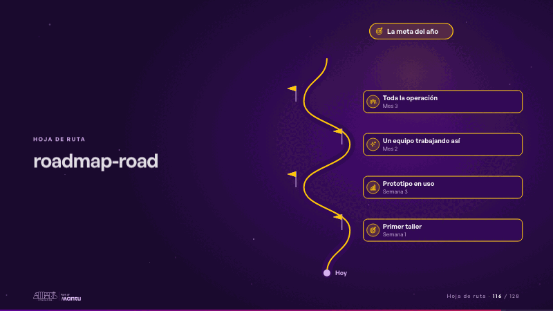
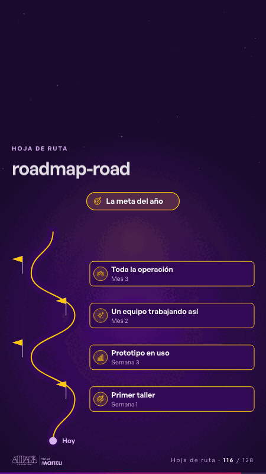

# roadmap-road · Hoja de ruta

 

## Qué cuenta

Un camino sube serpenteando desde «Hoy» hasta la meta, arriba; a los lados, cuatro banderas con su hito, su periodo y un ícono de su sector.

## Cómo respira

Un vehículo sube el camino y lo deja encendido; cada bandera se ilumina cuando pasa y, al llegar arriba, se enciende la meta. Queda: el camino recorrido y los cuatro hitos encendidos.

## Cuándo usarla

Intención: **Hoja de ruta** (roadmap, vision). Verticales: cualquiera. Layout `left`. Origen: dcd 0.6.0 · escena de catálogo. El snippet completo, listo para pegar en un storyboard: [`snippets/roadmap-road.json`](../../snippets/roadmap-road.json).

## Args

```json
{
 "layout": "left",
 "scene": "roadmap-road",
 "args": {
  "start": "‹como: Hoy›",
  "milestones": [
   [
    "‹como: Semana 1›",
    "‹como: Primer taller›"
   ],
   [
    "‹como: Semana 3›",
    "‹como: Prototipo en uso›"
   ],
   [
    "‹como: Mes 2›",
    "‹como: Un equipo trabajando así›"
   ],
   [
    "‹como: Mes 3›",
    "‹como: Toda la operación›"
   ]
  ],
  "goal": "‹como: La meta del año›"
 }
}
```

## What it is

Roadmap scene, layout «left», for any decks. It lands at a glance, then breathes in a slow loop; its args (goal, milestones, start) carry every visible word, so the same scene serves a new client once the texts are rewritten.

## Relacionadas · Related

- [arq-roadmap · Próximo paso: formas de empezar y discovery](arq-roadmap.md)
- [care-center · Cierre: su futuro, funcionando (el lema)](care-center.md)
- [controlroom-live · Cierre: su futuro, funcionando (el lema)](controlroom-live.md)
- [lema-conversation · Cierre: su futuro, funcionando (el lema)](lema-conversation.md)
- [lema-signer · Cierre: su futuro, funcionando (el lema)](lema-signer.md)
- [luz-end · Cierre: su futuro, funcionando (el lema)](luz-end.md)

Fuente · source: [`scenes/story/intents_s01_08.py`](../../scenes/story/intents_s01_08.py) · sha256 `40167e45ae96`
